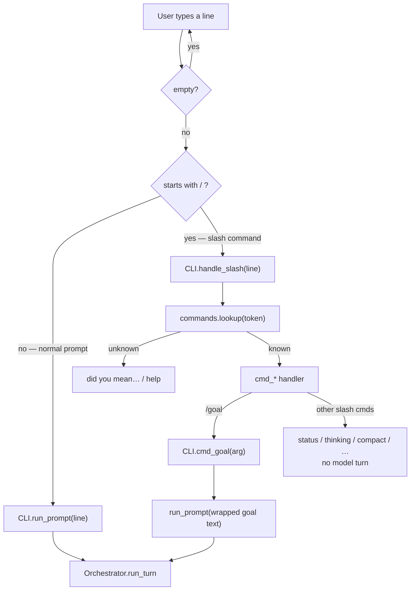
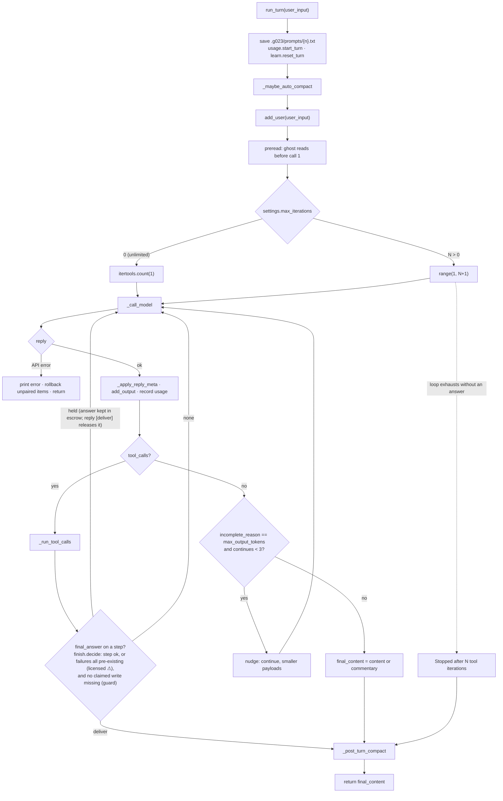
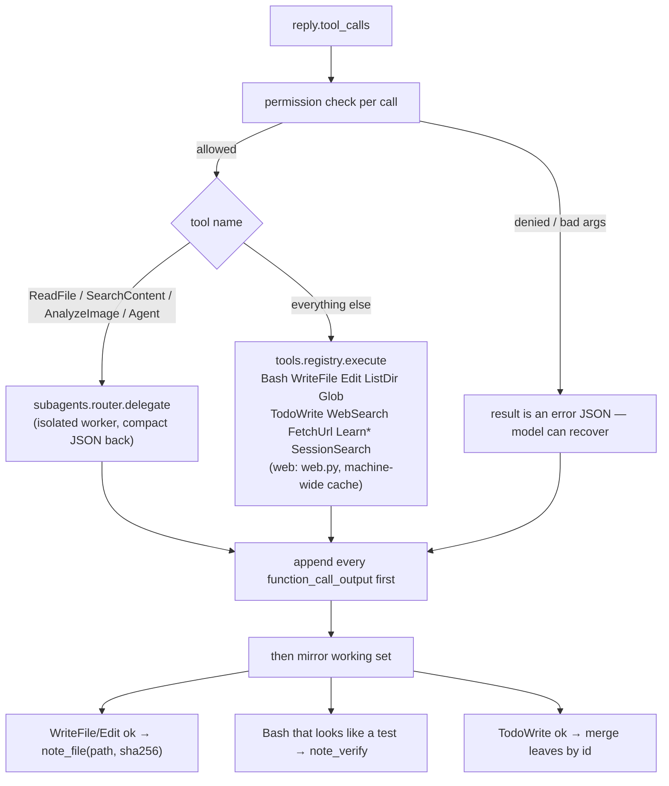
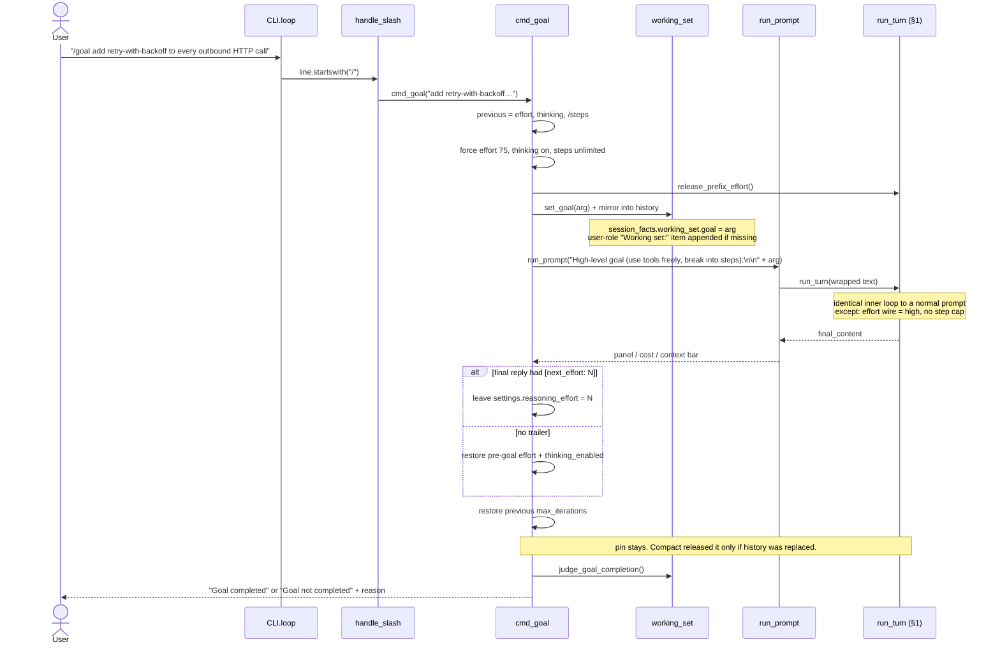

# Process flow — a prompt vs `/goal`

How a line of input becomes a DeepSeek turn, and how `/goal <objective>`
wraps that same turn with a different envelope.

Both paths share one inner loop: `CLI.run_prompt` → `Orchestrator.run_turn`.
`/goal` is not a second engine. It is a wrapper that retunes effort, lifts
the step cap, seeds the working set, rewrites the user text, then runs the
normal turn.

Source of truth: `g023_code/cli.py` (`loop`, `handle_slash`, `cmd_goal`,
`run_prompt`), `g023_code/orchestrator.py` (`run_turn`, `_run_turn_loop`),
`g023_code/working_set.py` (`set_goal`, `judge_goal_completion`).

---

## 0. How a line is classified

Interactive REPL (`CLI.loop`) classifies every line. One-shot argv
(`python -m g023_code …`) does the same for a *known* slash command:
`/goal …` is `cmd_goal`, not a prompt. An unknown `/…` stays user text.



---

## 1. Normal prompt

Anything that does **not** start with `/` is a prompt. The CLI does not
change effort, step cap, or the working-set goal. It hands the raw line to
the orchestrator.

### 1.1 Sequence

```mermaid
sequenceDiagram
    actor User
    participant REPL as CLI.loop
    participant Run as CLI.run_prompt
    participant Orch as Orchestrator.run_turn
    participant Loop as _run_turn_loop
    participant API as DeepSeek /anthropic/v1/messages
    participant Tools as tools / subagents

    User->>REPL: "add a retry helper"
    REPL->>Run: run_prompt(text)
    Run->>Orch: run_turn(text)

    Orch->>Orch: usage.start_turn, save_prompt, learn.reset_turn
    Orch->>Orch: _maybe_auto_compact (Layer 1 at window pressure; Layer 3 at ceiling or when ski-rental rent >= price)
    Orch->>Orch: state.add_user(text)
    Orch->>Orch: preread ghost: predicted ReadFile/SearchContent calls run as the model's own exchange + note (docs/preread.md)
    Orch->>Loop: _run_turn_loop(steps = /steps cap, or unlimited if 0)

    loop each iteration until answer, cap, error, or Ctrl-C
        Loop->>Loop: _reseat_items_splitting_tool_pairs
        Loop->>API: _call_model (frozen instructions + tools + effort)
        API-->>Loop: Reply (content / tool_calls / reasoning / usage)
        Loop->>Loop: _apply_reply_meta (strip [handoff] / [next_effort])
        Loop->>Loop: add_output, usage.record, signals
        alt tool_calls
            Loop->>Tools: _run_tool_calls (Edit may carry more_edits across files; Rename = one call)
            Tools-->>Loop: function_call_output items
            Note over Loop: finish.decide on a carried final_answer (licensed / escrow / claimed-write guard, docs/finish.md)<br/>else continue — another model call
        else incomplete_reason == max_output_tokens<br/>and no tools (cap 3)
            Loop->>Loop: add_user(smaller-payload nudge)
            Note over Loop: continue
        else final text (or commentary)
            Note over Loop: break
        end
    end

    Loop->>Loop: _post_turn_compact? (judge / leftover / hot prefix)
    Loop-->>Run: final_content
    Run->>User: panel (if not already streamed) + cost / context bar
```

### 1.2 Turn loop (same box `/goal` reuses)



### 1.3 One model call

Standing `instructions` and the tool list are frozen until vision changes.
Effort and temperature are pinned to the current prefix (`_prefix_effort_wire`)
until `/thinking`, `/clear`, or a successful post-turn compact releases
them. `/goal` releases only before its own turn, then the turn re-pins
the ceiling.

```
POST /anthropic/v1/messages        (anthropic_codec translates; the only wire)
  model:            deepseek-flash   (config.MODEL — forced by DeepSeekClient)
  instructions:     ORCHESTRATOR_SYSTEM
                    + vision clause
                    + g023_compact.md (else g023.md)
                    + project-root AGENTS.md (if readable)
  input:            OrchestratorState.items  (typed items, not chat messages)
  tools:            registry schemas (WebSearch/FetchUrl are client tools)
  reasoning.effort: wire alias of the pinned prefix effort
                    (0→none, 1–50→low, 51–75→high; never max)
  temperature:      pinned prefix temperature
  max_output_tokens: omitted when /max-tokens is off
```

### 1.4 Tool dispatch (when the model calls tools)



Calls run in **program order** (`_batch_segments`): consecutive ALLOW
read-only calls (ReadFile, SearchContent, ListDir, Glob, LearnSearch,
LearnGet, SessionSearch) form one segment and overlap; every write, Bash call
or ASK tool is a barrier that runs alone, so a read listed after a write sees
it. On Ctrl-C, finished results are kept and the rest get an "interrupted"
result; the turn then rolls back as a transaction (completed pairs kept). Every result is first encoded by
`tool_codec.encode_tool_result` (dense header, outline, grep-style search,
raw file text; see `docs/tool_codec.md`). Then bulky Bash / ListDir / Glob
bodies are vaulted at append time, so they never enter a cache unit as raw
text.
The vault excerpt keeps the lines that match the step's intent (the tail of
the reasoning that issued the call, `salience.py`), and the full raw output
stays in `.g023/vault/<id>.txt` for a ReadFile range or `grep -n` instead of a
re-run. Before a Bash call runs, `local_llm.note_command` checks it for GPU
work; a match makes the optional local model (LocalAsk, rerank, local vision)
yield for the rest of the turn (`docs/local_model.md`).

History integrity is a hard invariant: every `function_call` must have a
matching `function_call_output`. A user-role working-set item must not land
between a parallel batch and its outputs. The orchestrator reseats, repairs,
or rolls back rather than leave a broken history.

### 1.5 After the model answers

Trailers on a **final** (no-tool) reply are stripped from what the user sees:

```
[handoff]
## Goals / Files / Decisions / Done
[/handoff]
[next_effort: N]
```

- `[handoff]` is only requested when the user item ends with `[handoff due]`.
  `run_turn` adds that line when `_handoff_due_forecast()` predicts a
  compaction within ~2 turns, and the reply carries the block only then.
- A complete `[handoff]` (cumulative over the whole session, since it replaces the transcript) is stored as `_last_handoff` for compact reuse.
- A valid `[next_effort: N]` (0–75) updates in-memory `settings.reasoning_effort`
  for when the prefix is new. The wire alias stays pinned on this prefix.
- Trailers on a tool-call step are stripped, not applied.

Then `_post_turn_compact` may replace the transcript so the next request is
standing instructions + working-set item + summary:

| Compact when | Skip when |
|---|---|
| working-set judge says the objective is complete | leftover history &lt; 4,000 chars (short chat / small tool turn) |
| context window is full | hot prefix (last-call hit rate ≥ 0.5) and the objective is still open |
| leftover bulk is large **and uncached** | Layer 3 already shrank a still-open objective |

Summary source, in order: same-response `[handoff]` (no API cost) → local
fold of an existing compact-summary item → Flash. A successful replace
writes `.g023/logs/{YYYYMMDD_HHMMSS}.log` and `release_prefix_effort()`.

A final assistant message is **not** success. `judge_goal_completion()` is
the only completed / not-completed verdict (pending leaves, done-without-
evidence, or an empty leaf list → not completed).

---

## 2. `/goal <objective>`

`/goal` is the Work-group slash command (`commands.py` → `CLI.cmd_goal`).
Bare `/goal` prints usage and returns. With an argument it wraps a
normal turn at effort 75 with no step cap. If `judge_goal_completion`
still says not completed, it runs at most two more turns whose user text
names the open leaves. A continuation that does not change the working
set stops immediately. Then it restores the session knobs.

### 2.1 What `cmd_goal` changes before the turn

```mermaid
flowchart TD
    G["/goal add retry-with-backoff to every outbound HTTP call"] --> U{arg empty?}
    U -->|yes| USAGE["print usage · return"]
    U -->|no| SAVE["stash previous:<br/>reasoning_effort, thinking_enabled, max_iterations"]

    SAVE --> FORCE["settings.reasoning_effort = 75 (MAX_EFFORT / high)<br/>settings.thinking_enabled = True<br/>settings.max_iterations = 0 (unlimited)"]
    FORCE --> REL["orch.release_prefix_effort()<br/>so this turn is not stuck on the old wire alias"]
    REL --> WS["set_goal(arg) → working_set.goal<br/>mirror_working_set(...) into history"]
    WS --> BANNER["print: Goal · ceiling reasoning effort (75), no step limit"]
    BANNER --> WRAP["run_prompt(<br/>  'High-level goal (use tools freely, break into steps):\\n\\n' + arg,<br/>  title = 'g023 · goal'<br/>)"]
    WRAP --> TURN["same Orchestrator.run_turn as §1<br/>re-pins the ceiling alias"]
    TURN --> FIN["finally:"]
    FIN --> NE{"orch._next_effort_applied?"}
    NE -->|no [next_effort] on final reply| REST["restore pre-goal effort + thinking_enabled"]
    NE -->|yes| KEEP["keep the trailer's effort in settings"]
    REST --> CAP
    KEEP --> CAP["always restore previous max_iterations"]
    CAP --> HOLD["do not release the pin<br/>the goal transcript stays the warm prefix<br/>compact already released if it replaced history"]
    HOLD --> JUDGE["_emit_goal_judgment() → judge_goal_completion()"]
    JUDGE --> LINE["print 'Goal completed' or 'Goal not completed' + reason"]
```

### 2.2 Sequence — the extra envelope around the same turn



### 2.3 What the model actually receives as the user item

Not the raw `/goal …` line. The orchestrator sees a wrapped user message:

```
High-level goal (use tools freely, break into steps):

add retry-with-backoff to every outbound HTTP call
```

That text is also what `save_prompt` writes to `.g023/prompts/{n}.txt`.

The working-set object (SQLite `session_facts`, key `working_set`) now has
`goal` set to the raw objective. The history mirror is a user-role item
starting with `Working set:\n` plus stable JSON. It is **appended**, never
rewritten in place (prefix-cache invariant).

### 2.4 After `/goal` returns

`_emit_goal_judgment` prints one line from `judge_goal_completion()`:

| Working set | Verdict |
|---|---|
| Any leaf still `pending` / `in_progress` | not completed — *N open leaves still pending* |
| A `done` leaf with no file evidence and no recorded passing verify | not completed — *done leaves missing evidence* |
| No leaves at all | not completed — *no working-set leaves with evidence* |
| Every leaf `cancelled` | not completed — *every leaf was cancelled; nothing was finished* |
| Last test-like Bash exited non-zero | not completed — *last verify failed* |
| No open leaves; at least one `done` leaf cites a file pointer or a verify command that exited 0; last verify did not fail | completed |

While the verdict is not completed, `cmd_goal` appends a short continuation
prompt (cap 2, `GOAL_CONTINUATION_CAP`) and calls `run_prompt` again. The
prefix already sent stays; the new user item is a tail. If that turn does
not change `dumps_working_set`, the loop stops instead of buying the same
refusal again. Ctrl-C or an API error skips the rest.

The saved `/steps` value is never written by `/goal`. The lift is for this
turn only. `/thinking` remains the persisted session default; a same-response
`[next_effort]` is in-memory only.

---

## 3. Side by side

| | Normal prompt | `/goal <objective>` |
|---|---|---|
| Dispatch | `loop` → `run_prompt(line)` | `loop` → `handle_slash` → `cmd_goal` → `run_prompt(wrapped)` |
| User item text | exactly what was typed | `"High-level goal (use tools freely, break into steps):\n\n" + objective` |
| Reasoning effort | current `/thinking` dial, prefix-pinned | forced **75 / `high`** for this turn; pin released first, then re-pinned. Not released when `/goal` returns |
| Step cap | `settings.max_iterations` (`/steps`; 0 = already unlimited) | **0 (unlimited)** for this turn only; saved `/steps` restored after |
| Working set | unchanged at turn start (TodoWrite / WriteFile / test-like Bash still update it mid-turn) | `set_goal(objective)` + history mirror **before** the turn |
| Inner loop | `run_turn` → `_run_turn_loop` | same |
| Auto-continue on output ceiling | yes, cap 3 | same — this is why a goal that thinks until the ceiling can keep writing |
| Post-turn compact | same policy | same policy — more likely to fire because a finished goal trips the judge |
| After the turn | restore nothing | if the judge says open, up to 2 continuation turns, stopping when the working set does not change; then restore `/steps`; restore the effort dial unless `[next_effort]` landed; leave the wire pin so the transcript still hits; print **Goal completed / not completed** |
| Config files | untouched | untouched (`/thinking` stays the persisted default) |

The part that matters: `/goal` does not grow a second agent. It changes
three knobs (effort, step cap, working-set goal), rewrites the user text
into an instruction to break the objective into tool-using steps, runs the
ordinary turn, then judges evidence rather than the assistant's last
sentence.

---

## 4. Where the two paths sit in the process

```
g023.sh / g023.bat
        │
python -m g023_code          argv: --help | --version | --continue | one-shot | REPL
        │
CLI.loop  ──────────────────────────────────────────────┐
        │                                               │
        │  "fix the tests"          "/goal fix the tests"
        ▼                               ▼
  run_prompt(raw)                 cmd_goal
                                        │  effort=75, steps=∞, set_goal
                                        ▼
                                  run_prompt(wrapped)
                                        │
                    ┌───────────────────┴───────────────────┐
                    ▼                                       ▼
            Orchestrator.run_turn                    (same function)
                    │
                    ├─ auto-compact if the window is full
                    ├─ add_user
                    └─ _run_turn_loop
                           │
                           ├─► DeepSeek /anthropic/v1/messages  (frozen prefix)
                           ├─► tools / subagents    (then another call)
                           ├─► output-limit nudge   (up to 3)
                           └─► post-turn compact    (handoff / fold / Flash)
                    │
                    ▼
            CLI prints answer + cost + context
                    │
                    └─ /goal only: restore knobs, print Goal completed|not completed
```

---

## Related

- `docs/overview.md` — module map and one-session walkthrough
- `docs/cli.md` — REPL, slash dispatch, `cmd_goal`, `run_prompt`
- `docs/orchestrator.md` — `run_turn`, history integrity, compact
- `docs/working_set.md` — remaining-work object and the completion judge
- `docs/effort.md` — 0–75 scale, `[handoff]` / `[next_effort]` trailers
- `docs/cost_policy.md` — keep vs compact vs vault
- `tests/test_goal_judge.py`, `tests/test_step_limit.py`, `tests/test_reasoning.py`
