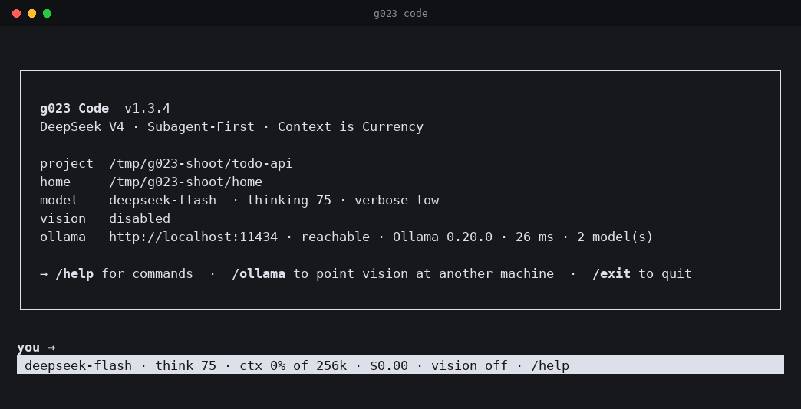
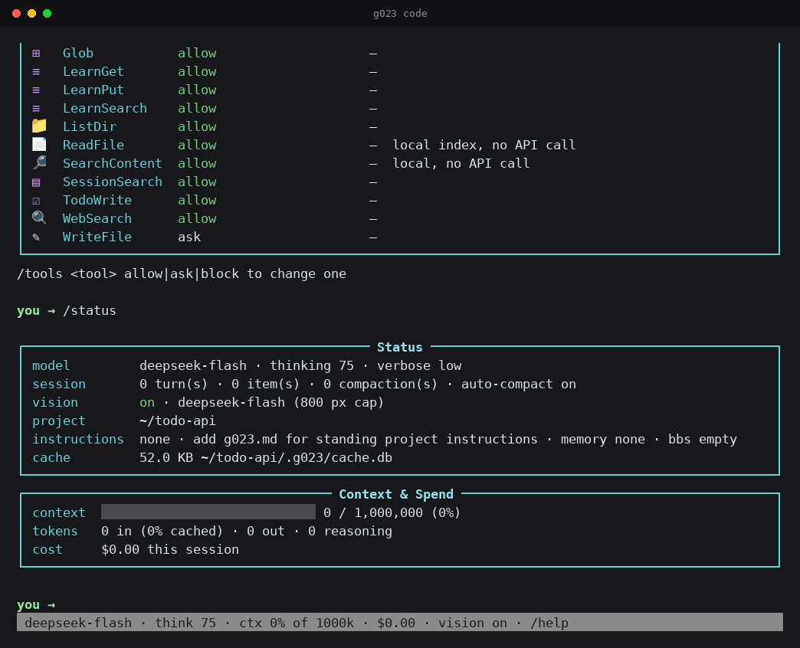
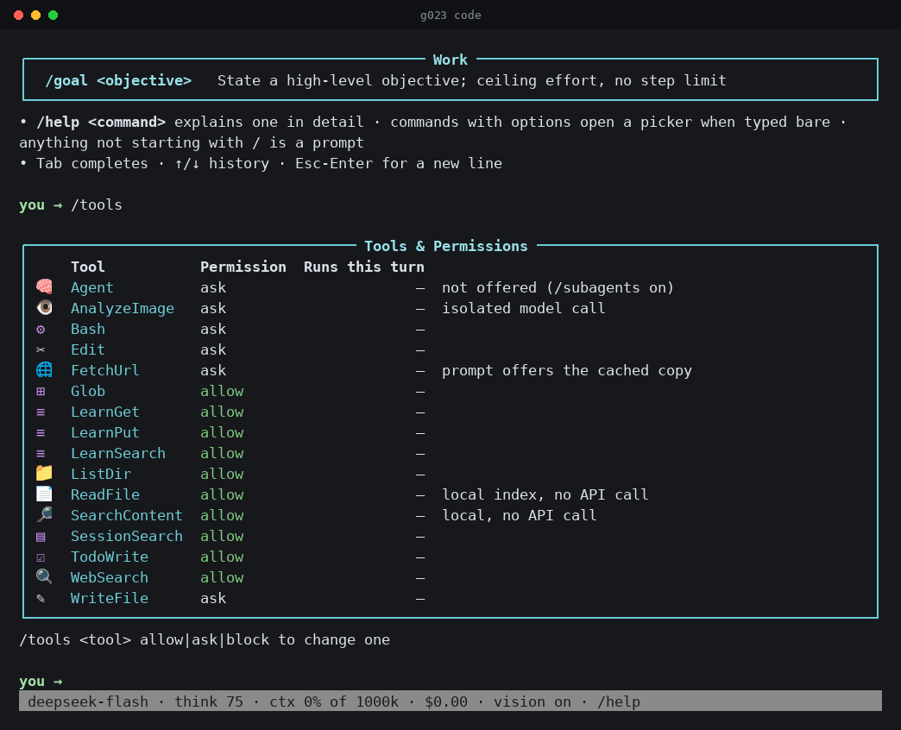
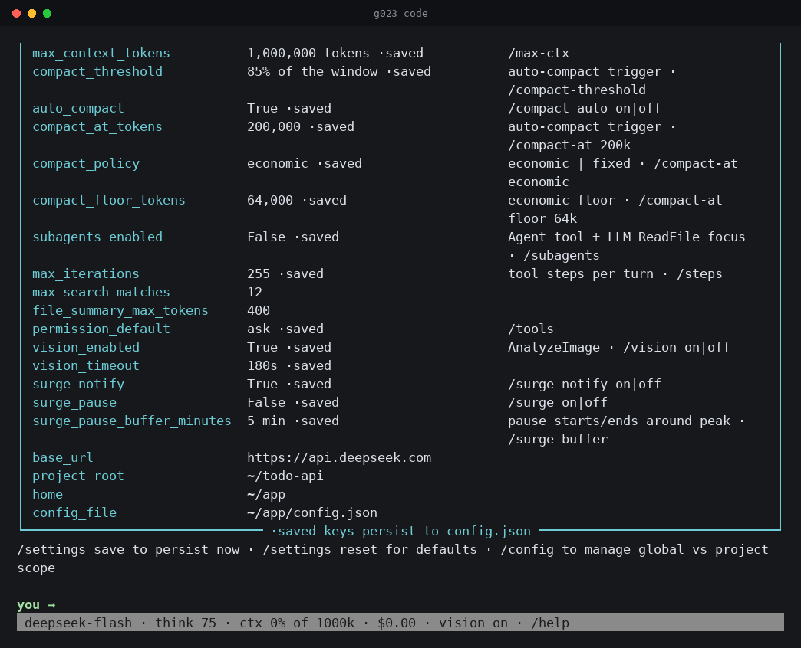

<div align="center">

# g023 Code

**A pure-Python AI coding agent for your terminal, powered by DeepSeek V4.1 Flash.**

*Single-agent by default · Context is Currency · Terminal-native*

[](https://www.python.org/)
[](CHANGELOG.md)
[](LICENSE)
[](https://platform.deepseek.com/)

</div>

---

g023 Code reads your project, searches it, searches the web, runs commands,
fetches pages, and looks at images — while telling you exactly what it is doing
and what it just cost. Think of the orchestrator as a miser with a gold card:
it will spend, but it wants the receipt, and it would rather send a specialist
than haul the whole warehouse onto the table.

It works **alone by default**: one orchestrator, no subagent model calls.
ReadFile answers locally with a structural summary plus a symbol → line-range
map (a free-text `focus` is ranked locally too). `/subagents on` brings back
the `Agent` tool and model-assisted focus for people who want delegation. When the summary is not enough, the orchestrator
asks for an exact line range and gets verbatim source — so "summary first,
raw on request" is the design, not "never raw".

That trade is a real trade, and it is worth being precise about which half of
it is measured. The call counts below are asserted by the test suite. Whether
delegation is *cheaper overall* is not: it depends on how many turns the
file's text would otherwise have sat in context, which no test here can know.
See [break-even](#what-delegation-costs) for the arithmetic and
[what we measured](#what-we-measured) for the numbers that *are* pinned.

It runs one model — **DeepSeek V4.1 Flash** (`deepseek-flash`) — through
DeepSeek's **Anthropic-format API** (`POST /anthropic/v1/messages`), and
reaches the web through two client tools on DeepSeek's **Search** and
**Fetch** APIs behind one machine-wide cache. One model, one wire, one key
(`K.dat`).

<p align="center">
  
</p>

<p align="center"><sub>Startup banner. Captured on 1.5.0; paths under the home directory print as <code>~</code> — see <a href="media/README.md">media/README.md</a>.</sub></p>

## Table of contents

- [Quick start](#quick-start)
- [What you see while it runs](#what-you-see-while-it-runs)
- [Configuration](#configuration)
- [Architecture](#architecture)
- [What we measured](#what-we-measured)
- [What delegation costs](#what-delegation-costs)
- [Drift signals](#drift-signals)
- [Project instructions (`g023.md`)](#project-instructions-g023md)
- [Slash commands](#slash-commands)
- [Verbosity, context & cost](#verbosity-context--cost)
- [Web search and pages](#web-search-and-pages)
- [Vision](#vision)
- [Optional local model (llama.cpp)](#optional-local-model-llamacpp)
- [Fetching web pages](#fetching-web-pages)
- [For researchers](#for-researchers)
- [Design principles](#design-principles)
- [Tests](#tests)
- [Extending](#extending)
- [Changelog](#changelog)
- [License](#license)

## Quick start

**Requirements:** Python 3.11 or newer, and a [DeepSeek API key](https://platform.deepseek.com/).

Drop the folder anywhere you like and run the installer inside it:

```bash
cd /path/to/g023-code
./installer.sh
```

<details>
<summary><b>Windows</b></summary>

```bat
cd C:\path\to\g023-code
installer.bat
```

</details>

It finds a Python 3.11+, builds a `.venv` in the folder, installs only the
dependencies you are actually missing, asks once for your API key, writes a
default `config.json`, and puts `g023` on your `PATH`. Every step checks what is
already true first, so running it again is safe — it is also how you repair a
half-finished setup or add the optional extras later.

<details>
<summary><b>Installer options</b></summary>

| Linux / macOS | Windows | Effect |
|---|---|---|
| `--yes` | `/y` | Non-interactive; take the recommended default everywhere |
| `--key sk-…` | `/key sk-…` | Write the key into `K.dat` instead of prompting (`$DEEPSEEK_API_KEY` is used if set) |
| `--with-optional` / `--no-optional` | `/optional` / `/nooptional` | Decide the extras (vision image downscaling) up front |
| `--no-venv` | — | Install into the current interpreter instead of a venv |
| `--no-path` | `/nopath` | Do not touch `~/.local/bin`, your shell rc, or the user `PATH` |
| `--uninstall` | `/uninstall` | Remove the launcher shim and `PATH` entry (the folder, `.venv`, `K.dat` and `config.json` stay) |

</details>

Then launch from whatever project you want it to work on:

```bash
cd ~/some/project
g023
```

Doing it by hand instead is three steps — `pip install -r requirements.txt`,
your key on the first line of `K.dat`, then `/path/to/g023-code/g023.sh` (or
`g023.bat`) from a project folder. The launchers prefer `.venv/` in the install
folder when one exists, and set two environment variables for you:

| Variable | Meaning |
|---|---|
| `G023_HOME` | The installation folder — where `K.dat` and `config.json` live |
| `G023_PROJECT_ROOT` | The directory you launched from — your project |

A per-project `.g023/` folder holds the SQLite cache, your input history,
`backups/` (every WriteFile/Edit overwrite snapshots the previous version,
mirroring the file tree, newest few kept per file), `sessions/` (append-only
JSONL), `logs/` (objective handoffs for `--continue`), `prompts/` (each user
prompt, recalled with Ctrl+Up), optional `memory/` / `learn/` stores,
and a bulletin board at `.g023/bbs/`.

`prompt_toolkit` is listed as a dependency but is not strictly required: with it
you get tab completion, persistent history, a live status bar pinned to the
bottom of the terminal, and Ctrl+Up to recall the last stored prompt from
`.g023/prompts/`. Without it the input line falls back to a plain prompt
and everything else behaves identically.

## What you see while it runs

The point is to never wonder what it is doing, or what it just cost.

<p align="center">
  
</p>

Tool traces say what *happened* (`708 lines, 9 classes, cached`), not what was
sent. The status line after every turn carries the numbers that only mean
something together — context used, **cache hit rate**, cost of this turn, cost
of the session — because on V4.1 Flash a cached input token is billed at $0.003/M
off-peak against $0.15/M for an uncached one, and both double during surge
hours (peak times are 09:00–12:00 & 14:00–18:00 Beijing time, Monday–Friday). The hit/miss
gap is DeepSeek's price sheet, not something this harness achieves; what the
harness does is avoid breaking the prefix so more tokens fall on the cheaper
side.

Costs shown are computed locally from the token counts the API returns and the
price table in [`ds_pricing.json`](ds_pricing.json) (see [`docs/usage.md`](docs/usage.md)).
They are an estimate of your bill, not a reading of it.

Anything you type that does not start with `/` is a prompt. Everything else is
a slash command.

## Configuration

`/settings` shows every setting in one place and marks which ones persist
(`/settings set KEY VALUE` changes any of the persisted ones);
`/tools` shows what the agent may do and what it has done this turn. Both are
editable from inside the session, and the `·saved` keys are written to
`config.json` next to `K.dat` — the **global** default that follows you across
projects — or, if the project has one, to the project's `.g023/config.json`.

### Per-project overrides and the global default

Settings live in two layers:

- **Global** — `config.json` next to `K.dat`. Applies to every project.
- **Project** — `.g023/config.json` in the project folder. When present it
  overrides the global file for *this* project only.

```
/config              show both files and which scope is active
/config global       promote the current settings to the global default
                     (new projects inherit them)
/config save project pin the current settings to this project
/config save         save to the active scope
/config clear        drop this project's override; global applies again
```

So you can tune settings while inside a project, then run `/config global` to
make exactly those settings the default for every future project — even when a
project file would otherwise mask them.

<p align="center">
  
  
</p>

Defaults out of the box: **`deepseek-flash`** for the orchestrator and
everything, **no subagents** (`/subagents on` to opt in), thinking on at
effort **75** (wire alias `high`), verbosity **low**, a **1M** context window
with auto-compaction **on at 200k tokens** — checked after every tool batch,
not only at turn start (`/max-ctx`, `/compact-threshold 200k`), **WebSearch**
and **FetchUrl** on DeepSeek's Search and Fetch APIs through one **machine-wide
web cache**, acting **tools** set to **ask**, and
**vision on** (`/vision off` to drop the tool). Nothing that writes, runs, or leaves your machine
happens without a prompt.

## Architecture

Everything — orchestrator, compaction, vision — goes to one model and one
endpoint: `POST {base}/anthropic/v1/messages`. Internally the program still
keeps its history as item-shaped records (message / reasoning / function_call …); `g023_code/anthropic_codec.py`
translates them to Anthropic `messages` on the way out and translates replies
(blocking or SSE) back. The translation is deterministic — same items, same
bytes, fixed key order — so DeepSeek's prefix cache keeps hitting (measured:
1,920 of 2,098 input tokens cached on the call after a web search). Thinking
blocks are replayed with their `signature`; `server_tool_use` +
`web_search_tool_result` blocks from sessions recorded before 1.4 are replayed byte-for-byte.

The model's own output items go back into the next request *verbatim*:

- `message` items (your input; the model's narration and its final answer)
- `reasoning` items — echoed back unmodified so the model keeps its own chain
- `web_search_call` items — only in sessions recorded before the client WebSearch tool
- `function_call` / `function_call_output` pairs, one per tool call

Two rules fall out of that, and every part of the program respects them. A
`function_call` with no matching output is a hard 400 in either direction, so
compaction, truncation and error recovery all repair pairing before the next
request. And items are echoed byte-identical, because rewriting them both breaks
the prefix cache and desyncs the model's reasoning.

- **Orchestrator** (`deepseek-flash`) keeps only high-level reasoning, tool
  schemas, and compact summaries.
- **Local helpers** handle data-heavy work without a model call (the `Agent`
  tool and model-assisted focus exist only after `/subagents on`):
  - `FileReader` → local structural index + symbol → line-range map; a
    `focus` is resolved locally (exact phrase → outline section path → word BM25
    over symbols / windows) with the best match verbatim and every match carrying
    its section path. Plain-text files get an induced outline (docs/docindex.md). Only with `/subagents on` does a semantic
    focus ask Flash. Cached by content hash.
  - `Searcher` → metadata-first grep (`rg` if present, else `grep`, else a
    Python walk) — **no API call**. Total occurrence count is reported
    separately from a sample list.
  - `Agent` *(opt-in, `/subagents on`)* → isolated reasoning: `research` / `planning` / `todos` / `task`
    (`explore`/`plan` still work as aliases). Task workers can Edit/Write/Bash;
    research/planning are read-only.
  - `Vision` → one isolated `deepseek-flash` call per image (thinking off,
    800 px cap). The orchestrator's history never holds image bytes.
- **Web** (`g023_code/web.py`): `WebSearch` and `FetchUrl` call DeepSeek's
  Search and Fetch APIs ($0.75 / 1,000 requests each, shown in `/cost`) through
  one SQLite cache shared by every g023 instance on the machine. A repeated or
  reworded search, and any page a search already returned, costs nothing.
  See [docs/web.md](docs/web.md).
- **Lightweight tools** on the orchestrator: Bash, WriteFile, **Edit**
  (unique-span replace, fails closed), ListDir, **Glob**, **TodoWrite**
  (working-set leaves), WebSearch, FetchUrl, LearnSearch, LearnGet, LearnPut,
  SessionSearch
- **SQLite cache** → a repeated read of unchanged bytes is a local lookup and
  costs no API call
- **Prefix-cache-friendly**: instructions and tool definitions stay frozen
  until you change vision. Effort and temperature are pinned to that prefix
  too. The working-set item is never rewritten in place. A hot prefix
  (last call mostly cache hits) is kept: rewriting it to "save tokens"
  turns hits into misses and does not recoup (~294 turns to break even on
  blanking 500 cached tokens). Nested Agent calls reuse that frozen prefix
  so they hit it too. Bulky Bash/ListDir/Glob output is stored by hash
  and replaced with a pointer *before* it enters history.
- **Project-root confined**: ReadFile, ListDir, SearchContent, Glob, Edit,
  WriteFile, and `/undo` refuse paths that resolve outside the launch directory.
- **Learn store**: reusable procedures live in `~/.g023/learn` and
  `<project>/.g023/learn`. They are searched on demand (`LearnSearch` /
  `/learn`), never prepended to the system prompt.
- **Thinking mode** on a 0–100 dial (75 is the default), mapped onto effort
  aliases. On the Anthropic wire that is `thinking: {"type": "enabled"}` +
  `output_config.effort`; off is `thinking: {"type": "disabled"}` (temperature
  is only sent when thinking is off — DeepSeek ignores it in thinking mode).

**Model.** There is exactly one: DeepSeek V4.1 Flash (`deepseek-flash`, 1M
context). It is a constant, not a setting — no config file can name a model the
API will not serve, and `/model` only shows its limits and prices.

The presentation and command layers are deliberately separate from the agent:

| Module | Responsibility |
|---|---|
| `commands.py` | The command catalogue as *data* — one source of truth shared by `/help`, tab completion, and "did you mean". A command cannot be completable but undocumented. |
| `ui.py` | Theme, glyphs, gauges, and the compact renderings of tool calls and their results. Falls back to ASCII on terminals that cannot draw box characters. |
| `prompt.py` | The input line and the shared numbered picker. Degrades cleanly without `prompt_toolkit`. |
| `images.py` | Image loading for vision: project-confined paths or URLs, real media type, 800 px cap. |
| `salience.py` | Long-output excerpts picked by the step's own intent; full output kept as a readable `.g023/vault/` file. |
| `local_llm.py`, `local_ask.py` | Optional llama.cpp model: shared server, GPU guard, `LocalAsk` bulk reading with verbatim evidence, local-first vision. |
| `scout.py` | Turn-zero scout card: a free local pre-read of the project that puts verbatim, anchored lines in the request (docs/scout.md). |

See [`docs/`](docs/README.md) for the per-module specification.

## What we measured

A handful of things that look like opinions from the outside and are
actually pinned by a test, a live probe, or DeepSeek's published sheet.
Dated 2026-09-10 (price sheet) and 2026-09-14 (the probes). The suite
that holds this to account is **732 tests**, all offline (about 20 s).

**The price sheet, off-peak Flash (effective 2026-09-10).** Cache hit
$0.003/M, cache miss $0.15/M (~50×), output $0.60/M (~200× a hit). Peak
is exactly 2×, **Monday–Friday only**. Weekend hours that *look* like
Beijing 09:00–12:00 / 14:00–18:00 are off-peak — billing them as surge
was a real overcharge, and `ds_times.json` now carries `peak_weekdays`.

**Keeping a hot prefix beats shrinking it.** DeepSeek hits only on a
full prefix-unit match from token 0. Blanking 500 cached tokens to
"save" them busts a ~3k-token tail: recoup is ~294 further turns.
Coding sessions do not last 294 turns. So the shipped policy
(`cost_policy.py`) is: do not rewrite a cached prefix unless the window
is actually full, the leftover is uncached, or the objective is done.
Layer-1 auto-micro of already-sent items waits for window pressure.
Every tool result is encoded once by `tool_codec.py` before it enters
history: echoed args, duplicate views, and digest tails are dropped, and
search becomes grep-style hits. On the live bench this cut cost per solved
task about 2.3x. Bulky Bash / ListDir / Glob bodies are vaulted *before*
they enter a cache unit — append-only pointers, not a later middle rewrite.
The `[handoff]` summary is requested only on turns forecast to compact.

**Output is the remaining bill once the prefix is hot.** Reasoning
tokens are billed as output. Effort is pinned to the standing prefix
(changing it mid-stream is a cache miss); a stored `[next_effort: N]`
lands on the next request after `/thinking`, `/clear`, or a post-turn
compact that already replaced the input list. `/goal` releases the pin
only before its own turn, so that turn sends the ceiling, and leaves it
afterwards so the warmed transcript still hits. Temperature is pinned
the same way, so the request bytes (and the cache key) do not drift.

**FileReader buys Flash only for a semantic question.** Unfocused
reads of any language are a local index (AST for Python, structure for
JS/TS/Go/Rust/JSON/Markdown/…). A focus that is already a symbol in
that map — or a unique method suffix — is local too: 0 API calls, line
span returned. A sentence like "what does method_one do" is ranked locally
by default (0 calls); with `/subagents on` it costs 1 Flash call instead.
Tests pin both.

**Nested Agent workers reuse the parent's frozen prefix.** Children
used to miss from token 0 on a different system prompt and a subset
tool list. The orchestrator now publishes its frozen instructions,
tools, and pinned effort; nested `create()` reuses them; the worker
brief moves into the first user item. Execution still refuses tools
the kind does not allow. Depth-2 was measured and not shipped: a
grandchild is another miss plus another hop of output tokens.

**Two things we tried and rejected, with numbers.** Sharing the parent
prefix for *focused FileReader* looked tempting. FileReader
instructions are 802 chars (miss ≈ $0.000030); the parent prefix is
5267 chars (miss ≈ $0.000197) plus high effort on a none-thinking
extract. Not worth it. And do not slice ReadFile / Agent JSON at 6000
chars to "save context": a 10505-char `orchestrator.py` summary became
an unparseable 5590-char stump and the symbol map vanished. Vault
already offloads Bash/ListDir/…; the compact form stays intact.

**Not measured, and labelled as such.** Nobody has run a controlled
A/B of end-to-end session cost. `G023_READFILE_RAW=1` is the flag;
`/cost` is the meter. Until someone does that on their own codebase,
the honest claim is smaller context, not a cheaper bill.

## What delegation costs

Delegating a read is not free — it is a second API call, and sometimes it is the
wrong trade. Here is what is actually true, separated by how well it is known.

**Measured.** These call counts are asserted in `tests/test_call_accounting.py`,
so they are checked rather than remembered:

| Operation | API calls |
|---|---|
| `SearchContent`, any size | 0 — `rg` / `grep` / Python walk, no API call |
| `ReadFile`, unfocused (any language) | 0 — local index (AST for Python, structure for JS/TS/Go/Rust/JSON/Markdown/…) |
| `ReadFile`, same bytes again (cache hit) | 0 |
| `ReadFile` with `start_line`/`end_line` | 0 — returns verbatim source (lines over 2,000 chars clipped, marked `verbatim: false`) |
| `ReadFile` on a binary, CSV/JSON/JSONL, log, or >64 MB file | 0 — structural digest: image dims, archive members, SQLite tables, column profiles, JSON shape, log templates with exact rare-line counts (`docs/shapes.md`) |
| `ListDir` / `Glob` on thousands of entries | 0 — templated digest counting every entry (`frame_{00000..03999}.png  x4000`, `docs/dirmap.md`) |
| `ReadFile` with `raw=true` | 0 — returns the whole file verbatim (the FileReader never needs the API for this) |
| `ReadFile` with a `focus` that is an exact / unique-suffix symbol | 0 — looked up in the local map |
| `ReadFile` with a semantic `focus` hint | 1 — Flash honours the question |

**Arithmetic, given assumptions.** A 40 KB file is roughly 10k tokens. Inlined
into the orchestrator, it is re-sent on every subsequent turn — cheaply, if it
stays in the cached prefix, at $0.003/M (regular rate). An unfocused ReadFile
indexes it locally (zero API calls) and leaves a few hundred tokens of
structure in context instead of 10k. An exact-symbol focus is the same local
lookup. A *semantic* focused ReadFile still costs one Flash call (~10k in,
~300 out ≈ $0.0017 at regular miss rates). Which wins depends on how many
turns follow and whether the prefix survives them. **Delegation is not
unconditionally cheaper**; it is unconditionally *smaller*, and smaller
context is what keeps the model on task and the window from filling.

**Not measured.** Nobody has run a controlled A/B of end-to-end session cost.
The flag to do it exists:

```bash
G023_READFILE_RAW=1 g023      # ReadFile returns raw content, no subagent
```

With it set, whole-file reads return the file's bytes and cost zero API calls —
the baseline a plain agent loop would have. Run the same task script with and
without it and compare `/cost`. Until someone does that on their own codebase,
the honest claim is the one above: fewer tokens in the window; an extra call
only when a focus hint asks the model to read for a specific question.

**When the summary is not enough.** The known weakness of summary-first is that
a summary can silently drop the one detail that mattered, and nothing detects
that. What exists instead is a cheap way out: every Python summary carries

```json
"symbols": {"Orchestrator.run_turn": [412, 498], "parse_reply": [199, 262]}
```

with line numbers taken from the AST (decorators included), not from the model.
Escalating is then one targeted `ReadFile` with those two numbers, which returns
verbatim text and costs no API call. That turns "the summary was too thin" from
a re-read of the whole file into a precise second look. It does not turn it into
something the orchestrator notices automatically — that detector does not exist.

**For editing, a summary is never enough.** A summary omits code bodies, and
`WriteFile` *replaces the entire file* — so a write reconstructed from a summary
silently truncates the file. That is exactly how `config.py` got truncated once.
Three safeguards now cover it:

- Prefer **Edit**: `old_string` / `new_string` on a unique span. If the span is
  missing or not unique, the tool refuses and writes nothing — but the refusal
  carries the fix: every occurrence with its line and enclosing function (retry
  with `line=N`), or the closest region verbatim. Matching tolerates line-ending,
  trailing-space and consistent indentation differences; CRLF, BOM and file mode
  survive every edit, and writes are atomic (`docs/edit_engine.md`).
- `ReadFile raw=true` returns the **whole file verbatim** (capped at 200k chars)
  when a full rewrite really is required. The tool schema and the system prompt
  both say to hold exact bytes before WriteFile.
- Every WriteFile/Edit overwrite first snapshots the previous version to
  `.g023/backups/<path-to-file>/<timestamp>-<hash>.bak`, keeping the newest few
  per file. `/undo` copies the newest snapshot back.

## Drift signals

The client does not validate responses on purpose: an unknown field has to reach
the model without a client release. The price is that a *renamed* field fails
quietly — `output_text` returns `""`, the model looks silent, and nothing
raises. Silent degradation, not a crash, is the realistic worst case here.

`/signals` (alias `/drift`) shows the three cheapest observations that would move
first:

| Signal | What it catches | What it cannot tell you |
|---|---|---|
| Unknown item `type` in a response | An additive API change, at the earliest moment it is visible | Whether it matters |
| Empty output with no `incomplete_reason` | What a renamed content field looks like from outside | Whether the model simply said nothing |
| Prefix hit rate diffed against previous days | Anything that started breaking the prefix | Whether the cause is your prompt, the tool list, or the server |

The hit rate is stored per day in `.g023/cache.db` and compared against the
trailing baseline, so the comparison survives restarts. It needs two prior days
before it will call anything a baseline, and says so until then. `/cache clear`
does not erase it — it is a record of what happened, not cached data.

None of these is a diagnosis. A model behaviour change, a schema change, and
drift in your own prompts all present identically from here: same call, worse
output, no error. These signals make the change visible and date it; they do not
separate the causes.

## Project instructions (`g023.md`)

Drop a `g023.md` in the project root — the same role `AGENTS.md` plays in other
agentic CLIs — and it is appended to the system prompt. `/g023-compact` writes a
denser `g023_compact.md` from it (`deepseek-flash`, reasoning off) and leaves
the original in place. If the compact file exists, that is what the prompt uses;
delete it to fall back to `g023.md`. A project-root `AGENTS.md`, when readable,
is appended as well. None of the files is required.

## Slash commands

Commands that take a fixed set of options **open a picker when typed bare**, so
`/thinking` is as usable as `/thinking 50` — there is nothing to memorise.
`/help <command>` explains any one of them in full.

<details open>
<summary><b>Session</b></summary>

| Command | Action |
|---|---|
| `/help [command]` | List commands, or explain one in detail |
| `/status` | One-screen dashboard: model, context, cost, vision, cache |
| `/clear` | Reset the conversation, usage counters, and working set |
| `/resume` · `/resume log` | Load the latest JSONL session, or seed from `.g023/logs/` |
| `/learn [search\|get\|save\|forget\|outcome]` | Cross-session procedures (not in the system prompt) |
| `/bbs [list\|search\|read\|post\|index]` | Project bulletin board in `.g023/bbs/` (searched on demand, not in the system prompt) |
| `/undo [path]` | Restore a file from its newest `.g023/backups/` copy |
| `/exit` | Quit |
| `/config [status\|save\|global\|project\|clear]` *(alias `/cfg`)* | Show or manage the global vs per-project config scopes |

</details>

<details open>
<summary><b>Model</b></summary>

| Command | Action |
|---|---|
| `/model` | Show the model (DeepSeek V4.1 Flash), its limits, thinking levels and prices |
| `/surge` | DeepSeek surge pricing — status, notify, auto-pause around peak |
| `/thinking [1-100\|low\|high\|max\|on\|off]` | Set reasoning effort (75 default and ceiling; max aliases to 75; `on` restores the saved effort). Bare opens a picker: low / high / off |
| `/verbose [low\|mid\|high]` | How much detail to print while working |
| `/steps [n\|off\|default]` | Cap the tool steps one turn may take before it gives up (default 255; `off` for no cap, with progress printed every 10 steps) |
| `/max-tokens [n\|off\|default]` | Cap how long one reply may be (default `off` — no budget is sent, so the model's own maximum is the only ceiling) |

</details>

<details open>
<summary><b>Context & cost</b></summary>

| Command | Action |
|---|---|
| `/compact [focus]` | Summarise the history (`micro` = free local pass, `auto on\|off`) |
| `/g023-compact` | Compact `g023.md` → `g023_compact.md` (Flash, no reasoning; leaves the original) |
| `/max-ctx [n\|default]` | Set the context window ceiling (default 1M, DeepSeek's real limit) |
| `/compact-threshold [tokens\|fraction\|default]` *(alias `/compact-at`)* | When auto-compact fires: a token count (`200k` default, e.g. `150k`, `1m`) or a fraction of the window (`0.85`); the lower of the two wins. `economic` (default) / `fixed` picks whether compaction may also fire earlier, once re-reading the history has cost more than compacting would (`/compact-at floor 64k` sets the lower bound; see docs/economics.md) |
| `/subagents [on\|off]` | Opt in to the `Agent` tool and model-assisted ReadFile focus (default off) |
| `/ownership [auto\|user\|agent]` | Whose code the model may tidy: files it created (`auto`, default), none (`user`), whole project (`agent`) — see docs/ownership.md |
| `/context` | Break down what is occupying the context window, by role and size |
| `/cost` | Token usage and spend, split by cache hit/miss, with a per-turn sparkline |
| `/settings [save\|reset\|set KEY VALUE]` | Every setting, marking which persist; save, restore defaults, or change one saved key (typed and validated) |
| `/signals` *(alias `/drift`)* | Prefix hit rate against its own history, unknown item types, unexplained empty responses |

</details>

<details open>
<summary><b>Tools</b></summary>

| Command | Action |
|---|---|
| `/tools` | List tools, their permission level, and how often each ran |
| `/tools <tool> allow\|ask\|block` | Change one tool's permission |
| `/fetch <url>` | Fetch a URL yourself, with the cache/fresh prompt |
| `/search [fresh] <query>` | Search the web (machine-wide cache; `fresh` bypasses it) |
| `/cache [stats\|web\|web clear\|web prune\|clear]` | Cache sizes, web fees saved; purge the project cache or the machine-wide web cache |

</details>

<details>
<summary><b>Vision</b></summary>

| Command | Action |
|---|---|
| `/vision on\|off\|status` | Turn image analysis on or off (saved). Bare shows the state and asks whether to toggle |
| `/local [status\|auto\|on\|off\|tune\|unload\|models\|model NAME\|vision NAME\|scout MODE]` | Optional local llama.cpp model (`auto` by default: on only when `llama-server`, a model and a fitting GPU are found) |

</details>

<details>
<summary><b>Work</b></summary>

| Command | Action |
|---|---|
| `/goal <text>` | State a high-level objective; effort 75 (the ceiling), no step cap, and up to two continuations while the working-set judge says it is still open |

</details>

## Verbosity, context & cost

`/verbose` has three levels, persisted to `config.json`:

| Level | Shows |
|---|---|
| `low` *(default)* | The answer, plus a one-line trace of every tool call |
| `mid` | ↑ plus each tool's outcome and duration, and the per-turn token/cost line |
| `high` | ↑ plus the orchestrator's reasoning excerpts and per-iteration token counts |

`/context` answers the question `/cost` cannot: *what* is filling the window.
If tool results dominate, `/compact micro` clears the stale ones for free; if
it is real conversation, `/compact` summarises it on the standing prefix.
The command tells you which of the two applies. Auto-compact waits for
real pressure (default **200k tokens**, checked after every tool batch so a
long agentic turn is compacted mid-turn instead of growing toward 1M):
blanking a cached prefix every turn is a cache miss, not a savings. A
mid-turn compaction pins the request in progress, and every summary ends with
a `[recall]` line naming the on-disk transcript (`.g023/sessions/*.jsonl`) so
the model can `SessionSearch` exact details it no longer has. A finished objective still hands off to a
summary so the next request is a new orchestration. Turn auto-compact off
with `/compact auto off`, move the trigger with `/compact-threshold`, or
resize the window with `/max-ctx`.

Every API call — orchestrator *and* subagents — reports its token usage to a
single tracker, so `/cost` and `/settings` show the cache-hit / cache-miss /
output split per model and price it from [`ds_pricing.json`](ds_pricing.json)
(peak calls at the surge rate). Paid `WebSearch` and `FetchUrl` requests are
counted too, at $0.75 per 1,000 successful requests (a `Tools` line in
`/cost`); cache hits cost nothing and are counted separately.

## Web search and pages

Web access is two client tools on DeepSeek's own APIs: **`WebSearch`**
(`POST /v1/tools/search`) and **`FetchUrl`** (`POST /v1/tools/fetch`). Both are
billed $0.75 / 1,000 successful requests and shown in `/cost`. Both go through
**one SQLite cache shared by every g023 instance on the machine**
(`<install>/global_cache/web.db`, or `$G023_GLOBAL_CACHE_DIR`), so a search or
page already paid for in any project is not paid for again.

| | what it saves |
|---|---|
| **Pay once per machine** | Order, case, tracking params and URL fragments do not change the cache key |
| **Reworded searches reuse** | `asyncio.TaskGroup cancel others` ≈ `TaskGroup other tasks cancelled docs`; versions and `site:` must agree; the result names the cached query, and `fresh=true` forces a new search |
| **Search-primed pages** | Each search asks for every hit's full Markdown at the same fee, so FetchUrl on a hit costs nothing (`page cached` in the results) |
| **Query-aware freshness** | News/release/price queries keep 6 h, others 7 days; pinned URLs (commit SHAs, arXiv vN, DOIs) 30 days, most pages 1 day; refusals are remembered for 1 h |
| **Bounded pages** | A page over 8k chars returns a window plus an outline; `focus="topic"` returns the best sections (BM25, local, free), and `offset=N` continues |

Why client-side: DeepSeek's server-side `web_search` tool cost $0.001398 per
step in a live probe (it reads the prefix twice) and replayed about 2.2k opaque
tokens on every later turn, and none of it could be cached. Measured runs and
the design are in [docs/web.md](docs/web.md).

```
  ✓ WebSearch  asyncio TaskGroup cancel remaining tasks      5 results · cache
  ✓ FetchUrl   docs.python.org/3/library/asyncio-task.html focus=TaskGroup cancel
                                                              44,467 chars · focus · primed
```

`/search [fresh] <query>` and `/fetch <url>` do the same from the prompt.
`/cache` shows how many requests were paid, served from cache, or primed, and
the fees saved. `/cache web` lists entries; `/cache web clear` and
`/cache web prune` maintain the store.

## Vision

The orchestrator does not see image bytes. `AnalyzeImage` sends one image and
one question to the same model, `deepseek-flash`, as an isolated request
(thinking off) and returns a short text answer. Same `K.dat` key, same token
prices, counted in `/cost`.

```
/vision on       # offer AnalyzeImage to the model (saved)
/vision off      # stop offering it
/vision status   # show the current setting
```

- **Vision is on by default.** While it is off the `AnalyzeImage` tool is not
  even offered, so the model never proposes a call it cannot make.
- Local paths are confined to the project, like every other file tool;
  `http(s)` URLs are downloaded. jpeg, png, gif and webp are accepted and sent
  with their real media type.
- Images are capped so each edge is ≤ 800 px (needs `pillow` to downscale;
  an oversized image is refused if it is not installed). Smaller images are
  sent unchanged.
- Answers are cached by image hash + question, so asking the *same* question
  about the same image again is a local SQLite lookup.

Just ask: `analyze screenshot.png — what's the error?`

## Optional local model (llama.cpp)

Automatic. With a built [llama.cpp](https://github.com/ggml-org/llama.cpp), a
small GGUF model and a GPU it fits on, g023 hands free work to your own GPU
while the main loop stays on DeepSeek, in every project, with no setup:
`local_model` defaults to `auto`. The machine probe (`autotune.py`) looks for
`llama-server` (`local_llama_dir`, common checkout folders, `PATH`), models
(`local_models_dir`, `~/models`, LM Studio and llama.cpp caches) and the GPU,
then picks the best model measured on the scout eval (LFM3-VL-2B Q8, which also
answers screenshots, then LFM3-1.7B; any other small chat model by size). No GPU
means auto stays off: a CPU is too slow for per-turn help.

```
/local tune                          # what auto found and picked on this machine
/local auto | on | off               # default auto; on forces it, off never (or G023_LOCAL=1/0)
/local model LFM3-1.7B-Q8_0.gguf     # pin a model ('auto' unpins)
/local vision off                    # DeepSeek vision only ('auto': local when the model can see)
/settings set local_llama_dir ~/src/llama.cpp   # only if it lives somewhere unusual
```

- **Scout card** — before DeepSeek's first call, the local model reads the
  code units that best match your request (~1 s) and the request carries the
  lines it picked, verbatim and labelled as a lead, so the paid model can skip
  some of its own digging. Cards the model keeps ignoring switch themselves off.
  `/local scout local|always|off`.
- **LocalAsk** — the model can ask the local model to read big files (or a
  vault file of an earlier long output), or, with no paths, to search the whole
  project. Evidence lines are copied from the files, never generated; the short
  answer is marked as a small-model lead.
- **Vision** — local first; asking the same thing again goes to DeepSeek.
- **GPU etiquette** — one shared server per machine that drops to ~120 MiB of
  VRAM after 5 idle minutes; it stays off when another program is using the
  GPU, and it is released for the rest of the turn when a command looks like
  GPU work (CUDA, training, llama.cpp, ollama, vllm, ...).

Long outputs no longer need a re-run either way: the cut excerpt keeps the
lines that match what the model said it was looking for, and the full output is
kept under `.g023/vault/` for `ReadFile` ranges or `grep -n`. Details:
[docs/local_model.md](docs/local_model.md), [docs/scout.md](docs/scout.md), [docs/salience.md](docs/salience.md).

### Surge pricing (peak/off-peak)

DeepSeek moved to tidal pricing on 2026-08-17: peak hours are **09:00–12:00 and
14:00–18:00 Beijing time (UTC+8), Monday–Friday**; weekends are off-peak.
Off-peak is exactly half of peak. g023
converts the windows to **your local clock**, shows every time in **both
AM/PM and 24-hour format**, and can notify you and/or pause usage around them.
`/surge status` also counts down — **how many minutes to the next surge** and
**how long that surge will last** — and shows the regular vs surge (2×) prices
for each model, straight from `ds_pricing.json` / `ds_times.json`.

```
/surge               status: current state, local peak windows (AM/PM + 24h),
                     countdown to the next surge and its duration, prices
/surge notify on|off banner when surge pricing starts/ends (default on)
/surge on            pause usage from 5 min before peak until 5 min after it
                     ends, then resume automatically
/surge buffer <min>  widen the pause (default 5 min each side)
```

While a pause window is active the CLI waits it out instead of reading input, so
no requests are sent at double price; `Ctrl-C` bypasses it for that pass. The
toolbar shows `SURGE 2×` while peak hours are active.

## Fetching web pages

`FetchUrl` reads one page as Markdown via DeepSeek's Fetch API. It follows
`permission_default` (ask by default, `allow` for unattended runs). When a
cached copy exists, the prompt offers it:

```
Permission required to fetch https://example.com/pricing
Cached copy available — 12m ago, 48,210 chars (search prefetch)
Use cached copy, fetch fresh, or deny? [c/f/d] (c):
```

The model can pick a cache mode itself: `auto` (cache within its TTL or
`max_age`), `fresh`, or `cache` (never touch the network). URLs with
credentials are refused before any request is made. 408/429/5xx are retried
with backoff. On failure a cached copy is served with a note, and a 403/404
never overwrites a good copy.

> [!NOTE]
> Pages come from DeepSeek's fetcher, not from your machine: there is no
> local browser, no cookie jar, and no JavaScript engine. Login-only pages
> return nothing.

The service cuts some pages at exactly 20,480 bytes and gives no sign of it.
g023 detects that size and fetches one plain-text twin (`<url>.md` for doc
paths, raw.githubusercontent.com for GitHub blobs). It checks that the twin is
the same document, then caches the full text under the original URL. A page that
cannot be recovered is shown with `"complete": false`, so the model knows the
rest is missing.

## For researchers

g023 Code doubles as a small testbed for **cost-aware agent plumbing** on an
API that bills prompt-cache hits at ~1/50 of a miss and output at ~200× a
hit. Most of what follows combines known techniques; the table says which
part we could not find stated elsewhere. **Rating:** *existing* = a known
technique applied as-is; *derived* = known parts combined or adapted in a way
we did not find stated; *new?* = no prior art found in a non-exhaustive search
(treat as a lead, not a claim).

**How strong the evidence is.** Every mechanism below is pinned by offline
tests (`tests/`). The cost numbers are **small live benches** on
`deepseek-flash` (4–10 tasks, a handful of runs per variant, 2026-11-07/08),
reported as measured; they are not a controlled study, and run-to-run
variance on the same task was of the same order as some of the effects.
Treat them as effect sizes worth replicating, not results.

| # | Technique | Where | Rating | What it does | Evidence |
|---|---|---|---|---|---|
| 1 | Deterministic wire codec | `anthropic_codec.py` | derived | Item history → Anthropic `messages` with fixed key order and byte-identical replay, so the provider's prefix cache keeps hitting | 1,920 / 2,098 input tokens cached on the call after a web search (live) |
| 2 | Ski-rental compaction timing | `economics.py` | derived | Compact once the cache-hit *rent* of re-reading history since the last compaction reaches `fidelity ×` the price of compacting; equals the EOQ optimum under linear growth, 2-competitive in the worst case | Simulation: 87.2% of the cost of a fixed 200k trigger, vs 86.5% for the hindsight-best fixed threshold |
| 3 | Prefix-pinned effort | `orchestrator.py`, `effort.py` | derived | When the effort level is part of the cache key, per-step effort routing busts the prefix; pin effort to the standing prefix and retune only when the prefix is new anyway | ~100 output tokens/call saved by a lower level vs a ≥4k-token cache bust (live, 8 calls) |
| 4 | Tool-result codec at the history boundary | `tool_codec.py` | derived | Encode each tool result once, losslessly and idempotently, into its densest form *before* it enters cached history (drop echoed args, duplicate views; grep-style search hits) | 4-task bench: $0.00230 → ~$0.00100 per solved task (~2.3×, with #5 and ranked search sampling; single runs) |
| 5 | Just-in-time handoff solicitation | `orchestrator.py` | **new?** | Ask for the same-response compaction summary only on turns where a growth/rent forecast predicts compaction within ~2 turns (in-band `[handoff due]` marker) | Saves 116–323 output tokens on every other tool turn |
| 6 | Local BM25 focus over symbol spans | `subagents/file_reader.py`, `docindex.py` | derived | A free-text "focus" on a file is answered by local BM25 over AST symbol spans and gaps instead of a model call | One live turn: $0.00105 / 3 iterations → $0.00019 / 2 |
| 7 | Plain-text heading induction | `docindex.py` | derived (title promotion: *new?*) | Recover a section tree from unmarked text by line shape, keyword ranks, boilerplate suppression, implied parents; an ALL-CAPS line before a numbering reset becomes the work title | 5.4 MB → full tree in ~0.1 s, no model; 6-task long-document bench $0.000947 → $0.000659 per solved task |
| 8 | Breadcrumb-addressed hits, fold-to-budget outlines | `docindex.py`, `subagents/searcher.py` | derived | Every search/focus hit carries its enclosing function or section path; outlines fold breadth-first to a budget with explicit `+N` counts, never silent truncation | Offline tests; part of #7's bench |
| 9 | Machine-wide canonical web cache | `web.py` | existing | One SQLite (WAL) store for every instance; canonical query/URL keys; TTL chosen by query or URL kind; a ledger of fees saved | Offline tests |
| 10 | Search-primed fetch | `web.py` | derived | A flat per-request fee makes "include page content" free at the margin, so one search pre-fills up to 10 pages byte-identical to the Fetch API | Live: a primed fetch cost $0 and took 41 ms; 5 operations cost 2 paid requests |
| 11 | Near-duplicate query reuse with a fee threshold | `web.py` | derived | Stemmed-Jaccard reuse of earlier searches; scope operators must agree and version numbers veto; the threshold is derived from prices (reuse pays above ~30% usefulness) | Replay of agent rewordings: 3/5 reused (exact keys: 0/5) |
| 12 | Anticipatory tool results | `edit_engine.py`, `tools/registry.py` | derived | Fold the predictable, locally free next observation into the current result when P(needed) × hop cost > added tokens × rent: small files whole, a missed Edit returns the closest region or every occurrence, exit 127 names `python3` | Write-side bench (10 tasks): $0.001810 → $0.001451 per solved task, 92 → 65 calls, 4 → 0 edit errors |
| 13 | Affine indentation-map matching | `edit_engine.py` | derived | A fuzzy `old_string` rung solving `file_w = a + f·old_w`, proven on every non-blank line (2→4-space drift, quoted blocks); `new_string` is re-indented through the same map; unique matches only | Offline tests |
| 14 | Epoch-aware repeat guard | `orchestrator.py` | derived | Loop guards key reads/runs on (write epoch, call) and writes on the call alone: test → edit → test is new information, the same Edit three times is a loop | Offline tests |
| 15 | Verify replay | `orchestrator.py` | derived | After a successful write, re-run the check that failed this turn (allowed, < 30 s, chosen by the model) and attach `{exit_code, tail}` to the write's own result | Part of #12's bench |
| 16 | Counterfactual failure attribution | `attribution.py` | derived | When a check fails after this turn's writes, re-run it in a shadow copy with the turn's pre-images restored and label failures *new* / *pre-existing* / *fixed*; sound by an effect-based taint (stat fingerprint around every Bash call) | 65 live runs, all solved; cost per task neutral within noise ($0.001443 → $0.001428); unaided, the model rebuilt this counterfactual by hand at 3 extra hops |
| 17 | Nothing variable before the tool schemas | `orchestrator.py` | existing (re-measured) | A per-project path at the end of the instructions forks the cache before the tools | Call-1 hit/miss 1,408 / 3,875 tokens per new project, vs 5,120 / 168 without it |
| 18 | Test oracle | `testoracle.py` | derived | pytest run through Bash also writes a report outside the project; the result gains only what the model's own output filter hid (failing id, `@ path:line`, error, vacuous new tests) | delta-only version −14% mean $ on 5 write tasks × 6; listing passing new tests was +11% |
| 19 | Request obligations + write guards | `obligations.py` | derived | Signatures the request names are checked by `ast` before the final answer (one note); "do not change ..." refuses the first write to a protected file | method-vs-function misread task: 9/9 solved with vs 18/25 without (p = 0.09) |
| 20 | Claim check + callee digests | `claims.py`, `callees.py` | existing | A "tests pass" answer is compared with the turn's runs (note only); ReadFile lists imported project signatures | final check of all defaults vs off: 35/35 both, cost neutral ($0.001916 vs $0.001905) |
| 21 | Volatility-ordered bounded fold; signed, evidence-bound handoffs | `checkpoint.py` | derived | The state carried across post-turn compaction is ordered by how often it changes (narrative, then capped request digests, then a ring of the last 3 exchanges), so consecutive states share a cached prefix and the size has a fixed point; a handoff is HMAC-signed and, on resume, re-checked against the working set's file hashes, with drift and a stale passing verify reported to the model | Token model, 40 turns with a cold cache every 10: a sliding "last 3 turns verbatim" window costs 1.4× keeping the whole history (its head drops every turn, so the retained turns re-bill at the miss rate); the bounded fold costs 0.56× with ~9× smaller peak context (a model of token accounting, not a live bench) |

**Prior art we checked against** (non-exhaustive): ski rental
([Wikipedia](https://en.wikipedia.org/wiki/Ski_rental_problem)) and its use for
cache TTLs; Okapi BM25; aider's [repository map](https://aider.chat/docs/repomap.html)
and relative-indentation edit matching; MemGPT recall storage
([arXiv:2310.08560](https://arxiv.org/abs/2310.08560)); observation masking
([arXiv:2508.21433](https://arxiv.org/abs/2508.21433)); per-step effort routing
(ARES, arXiv:2603.07915); speculative actions
([arXiv:2510.04371](https://arxiv.org/abs/2510.04371)); provider-side compaction (OpenAI's
encrypted [compaction item](https://developers.openai.com/api/docs/guides/compaction), Anthropic's
[`compact_20260112`](https://platform.claude.com/docs/en/build-with-claude/compaction)) and signed
thinking blocks; ACON ([arXiv:2510.00615](https://arxiv.org/abs/2510.00615)); context rot
([Chroma](https://research.trychroma.com/context-rot)); semantic caches such as
[GPTCache](https://github.com/zilliztech/GPTCache); HTTP caching
([RFC 9111](https://www.rfc-editor.org/rfc/rfc9111)); SWE-agent's
[agent-computer interface](https://swe-agent.com/latest/background/aci/); and
SWE-bench `FAIL_TO_PASS` / `PASS_TO_PASS` with Agentless regression filtering.
The gap we found in each case is the one stated in the table: the billed
prefix cache as the cost model, not latency or a context-length budget.

**Reproducing.** Everything above runs from this folder:

- `python3 -m pytest tests -q` — the offline suite (no key, no network) pins
  every mechanism in the table.
- `G023_READFILE_RAW=1`, `G023_VERIFY_REPLAY=0`, `G023_ATTRIBUTION=0`,
  `/compact-at fixed` and `/subagents on` switch individual techniques off (or
  delegation on) for an A/B. The meters are `/cost` (tokens split by cache
  hit / miss / output, priced, with a per-turn sparkline), `/signals` (prefix
  hit rate per day, kept in `.g023/cache.db`) and `.g023/sessions/*.jsonl`
  (the full transcript plus prefix fingerprints).
- The arithmetic behind #2 and the break-even claims is in
  [`docs/economics.md`](docs/economics.md); the codec in
  [`docs/tool_codec.md`](docs/tool_codec.md), the web layer in
  [`docs/web.md`](docs/web.md), attribution in
  [`docs/attribution.md`](docs/attribution.md).

**What would make a paper.** #1 + #4 + #2 together support a short empirical
note on "cache-aware agent plumbing": hit rate and cost per solved task with
each technique ablated, over a task set large enough to beat the run-to-run
variance seen here. That benchmark has not been run.

## Design principles

1. **Context is currency** — keep raw files and search dumps out of the
   orchestrator unless they were asked for by line range.
2. **Local helpers are the treasury** — heavy I/O is answered by local
   indexes (AST, induced outlines, BM25) or, opt-in, by isolated subagents,
   and the escalation path back to verbatim source stays open.
3. **Cache everything cacheable** — file hashes, vision Q&A, fetched pages.
4. **Do it off-API where it is free** — search the filesystem, rank text and
   outline documents locally, and spend tokens only on reasoning.
5. **Thinking mode is a dial** (0–100, default 75), not always-on max.
6. **Say what happened, not what was sent** — and always say what it cost.
7. **Claim only what is checked.** Numbers in this documentation are either
   asserted by a test, quoted from a published price sheet with attribution, or
   labelled as an estimate. Where something is not measured, it says so.
8. **Retrieve, don't prepend** — learned procedures live in files and are
   searched on demand, so they cannot bust the prompt-cache prefix.
9. **Committed work survives** — Ctrl-C or a crash mid-write never loses a
   finished turn or a compaction summary, and what was interrupted is rolled
   back and said so. Two instances on one project keep each other's settings;
   one session log has one writer (two REPLs resuming the same session interleave).

## Tests

```bash
pip install pytest && python3 -m pytest tests/ -q
```

No plugins beyond `pytest` — async tests run through a small hook in
`tests/conftest.py`, and every test points `G023_PROJECT_ROOT` at a temporary
directory, so a run never reads your real cache and never touches the network.
**732 tests**, all passing, none of them on the network.

| File | What it holds to account |
|---|---|
| `test_call_accounting.py` | The API-call table above (unfocused ReadFile = 0, semantic focus = 1), counted against a stub client |
| `test_goal_cost_wins.py` | Exact-symbol focus = 0; no mid-JSON slice of ReadFile/Agent; nested Agent vaults bulky bodies; temperature pinned with the prefix |
| `test_cost_efficiency.py` | Rewriting a cached prefix does not recoup; post-turn compact keeps a hot prefix; Agent reuses parent instructions+tools+effort |
| `test_file_reader.py` | Symbol ranges are exact and in-bounds; truncation is declared; local AST facts outrank the model's |
| `test_drift_signals.py` | Each signal fires on the shape that matters and stays quiet on ordinary turns; hit-rate history survives restarts |
| `test_history_integrity.py` | Tool-call pairing survives rollback and repair; output items are echoed back byte-identical |
| `test_usage_accounting.py` | Cost arithmetic, both usage spellings, worst-case assumption when the split is unreported |
| `test_reasoning.py` | Effort 0–100 ↔ wire levels `none`/`low`/`high`, capped at 75; `[handoff]` / `[next_effort]` stripped from the visible answer |
| `test_learn.py` | Learn store round-trip, prefix pin, secret reject, cross-project env visibility |
| `test_session_log.py` | JSONL `/resume` and `.g023/logs/` handoff round-trip |
| `test_checkpoint.py` | Post-turn fold carries every new turn and stays bounded; signed handoff provenance; `[rehydrate]` on disk drift |
| `test_goal_judge.py` | Working-set completed vs not-completed from evidence, not from a final message |
| `test_prefix_stable.py` | Standing instructions + tools stay byte-identical until vision changes |
| `test_root_confine.py` | ReadFile / ListDir / SearchContent refuse paths outside the project root |
| `test_tool_codec.py` | ReadFile outline + byte-exact content, grep-style ranked search (`shown:"all"`), the `[handoff due]` forecast and marker |
| `test_search.py` | Total-vs-sample counts, gitignore, glob/brace, grep fallback, `.g023/memory/` and `.g023/bbs/` overlay |
| `test_bbs.py` | Bulletin board layout, slugs, retrieve-don't-prepend, search overlay, `/bbs` |
| `test_images.py` | Vision sends are capped at 800 px with the real media type, paths stay in the project, every request names `deepseek-flash` |
| `test_write_backup.py` | Every overwrite snapshots `.g023/backups/`; skipped for `.g023/` paths except `.g023/bbs/`, new files, unchanged content |
| `test_interrupt_and_concurrency.py` | A real SIGINT cancels only the running turn; interrupted turns roll back as a transaction; `/resume` replay equals memory; reads after a write see it; retries are bounded; stores survive concurrent writers |
| `test_durability_and_commit.py` | Summaries survive `/resume`; a torn log tail is repaired; Ctrl-C after the final answer keeps the turn; `/undo` restores the right version; no silent todo drops; per-key config merge |

The full suite is listed in [`docs/tests.md`](docs/tests.md).

What these do not cover: anything requiring the real API, end-to-end session
cost, or whether a summary was good enough for the question asked.

## Extending

- **New slash command** — add a `Command(...)` to `COMMANDS` in `commands.py`
  and a matching `cmd_*` method on `CLI`. Help text, tab completion, and "did
  you mean" pick it up automatically; `check_handlers()` fails at startup if the
  method is missing, so the two halves cannot drift apart.
- **New tool** — add a schema in `tools/schemas.py` plus an executor or a
  subagent route. Give it an entry in `ui.TOOL_STYLES` and a case in
  `ui.describe_call` / `describe_result` so its trace reads like the others.
- **Vision** — `images.py` (loading, media type, cap) and `subagents/vision.py`
  (the call, cache, usage); the router dispatches `AnalyzeImage` there.
- **Permissions** — `permission_default` (`allow` | `ask` | `block`) sets the
  starting level for the tools that act: `Bash`, `WriteFile`, `Edit`, `Agent`,
  `AnalyzeImage`, `FetchUrl`. The rest stay `allow`: they read, or write only
  g023's own stores (ReadFile, SearchContent, ListDir, Glob, TodoWrite,
  LearnSearch/LearnGet/LearnPut, SessionSearch, WebSearch). Per-tool overrides live in `tools/registry.py` and `/tools`.

Environment overrides:

| Variable | Effect |
|---|---|
| `G023_HOME` | Installation folder — where `K.dat` and `config.json` live |
| `G023_PROJECT_ROOT` | The project being worked on |
| `G023_ASCII=1` | Force plain-ASCII output on terminals that mangle box drawing |
| `G023_READFILE_RAW=1` | `ReadFile` returns raw content instead of delegating — the A/B baseline described in [What delegation costs](#what-delegation-costs) |
| `G023_WRITE_BACKUP=0` | Disable the automatic `.g023/backups/` snapshot before WriteFile/Edit overwrites |
| `G023_WRITE_BACKUP_KEEP=5` | How many backup versions to retain per file (minimum 1) |
| `G023_VERIFY_REPLAY=0` | Disable verify replay (re-running the last failing test command after a successful Edit/WriteFile, attached to the write's result) |
| `G023_ATTRIBUTION=0` | Disable failure attribution (re-running a failing check in a shadow copy with this turn's edits reverted, to label failures new or pre-existing) |
| `G023_FINISH_ON_SUCCESS=0` | Disable predicated finish: the step that completes a task may carry the final answer, delivered only if that step succeeds (on by default) |
| `G023_STEP_BUDGET=0` | Disable step budgets: `[budget MIN-MAX +OVER]` per step and the `[hop ...]` tracker on results (on by default; with predicated finish: $ −8 %, calls −16 %, time −10 % live) |
| `G023_PREREAD=off` | Disable pre-emptive reads: before the first model call the harness runs the reads the request makes predictable (named files, a named test's subject, the definition of a named function) as the model's own tool exchange (`ghost`, default; `prose` appends them to the request instead) |
| `G023_FINISH_LICENSED=0` | Disable licensed finish: an answer on a check whose failures all pre-date the turn is delivered with a ⚠ line (on by default) |
| `G023_ANSWER_ESCROW=0` | Disable answer escrow: a held-back answer is kept and the model can release it with `[deliver]` instead of re-writing it (on by default) |
| `G023_CLAIMED_WRITE_GUARD=0` | Disable the claimed-write guard: an answer saying a request-named file changed is held when no call wrote it (on by default) |
| `G023_MULTI_EDIT=0` | Remove Edit's `more_edits` (more hunks, optionally in other files, one call, all or nothing; on by default) |
| `G023_RENAME_TOOL=0` | Remove the `Rename` tool (whole-word identifier rename across the project, all files or none; on by default) |
| `G023_ORDERED_BATCHES=1` | Program-order batch contract in the prompt; a failed write skips the later checks of that response (opt-in) |
| `G023_WRITE_CHECK=1` | Edit/WriteFile carry an optional `check` command run after the response's writes if all succeeded (opt-in) |
| `G023_CLOSURE_RECEIPTS=0` / `G023_LEAN_CODEC=0` / `G023_LEAN_PROMPT=0` / `G023_ORIENT_CARD=0` | Turn off a lean-turn feature (docs/lean.md) |
| `G023_SCOPE_COUNT=1` | Scoped SearchContent also reports `elsewhere_in_project` |
| `G023_NEAR_MISS=0` | Disable near-miss names on a zero-hit SearchContent (the project's real spelling of the name searched for) |
| `G023_LEARN=0` | Disable the learn store (search/get/put become no-ops) |
| `G023_GLOBAL_CACHE_DIR` | Where the machine-wide web cache (`web.db`) lives (default `<install>/global_cache/`) |

## Changelog

What changed in each release: [`CHANGELOG.md`](CHANGELOG.md).

## License

MIT — see [`LICENSE`](LICENSE).
