# Screenshots

Every image here is a real terminal, recorded from a real session of **g023 Code
v1.3.2**. Nothing is mocked up and nothing is retouched: the numbers you see —
token counts, cache hit rates, per-turn costs, compaction savings — are what
those runs actually produced.

The main [`../README.md`](../README.md) links to these in context. This page is
the full index.

---

## Starting up

| | |
|---|---|
| [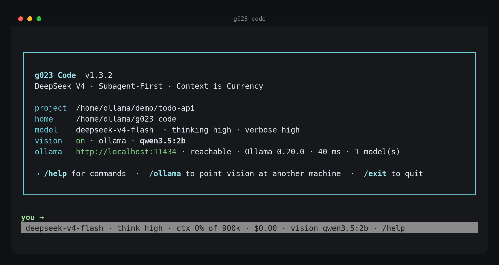](startup.png) | **`startup.png`** — the banner. Version, project root, program home, model and thinking level, and the vision backend with a live reachability probe of the Ollama daemon. |

## A turn, end to end

| | |
|---|---|
| [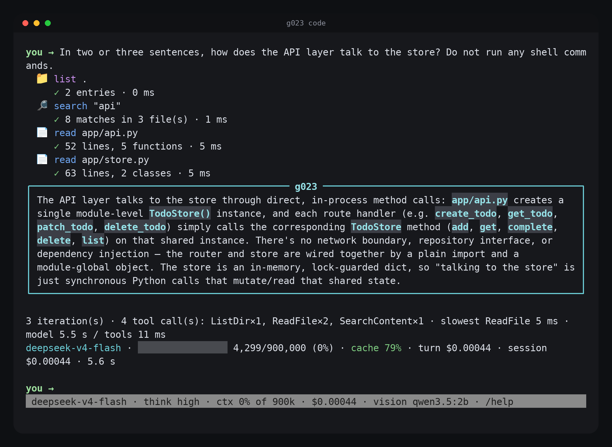](session.png) | **`session.png`** — one read-only question answered. The tool trace shows each call and its result line with timings (`list .` → 2 entries, `search "api"` → 8 matches in 3 files, two `read`s), then the boxed answer, then the accounting line: `3 iteration(s) · 4 tool call(s): ListDir×1, ReadFile×2, SearchContent×1 · slowest ReadFile 5 ms · model 5.5 s / tools 11 ms`, and the status bar `4,299/900,000 (0%) · cache 79% · turn $0.00044`. |
| [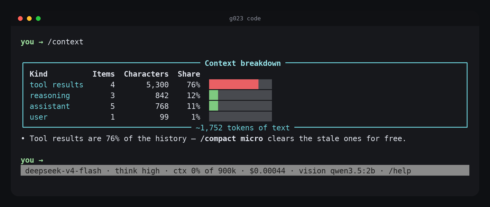](context.png) | **`context.png`** — `/context` after that turn. Tool results are 76% of a ~1,752-token history; the hint under the table names the cheapest fix. |
| [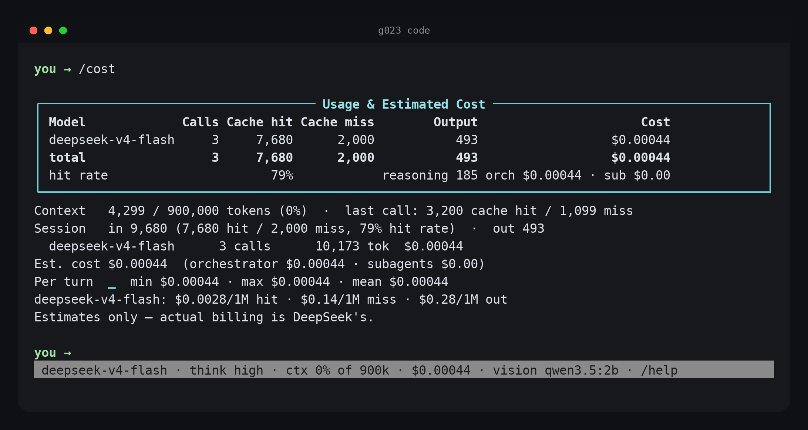](cost.png) | **`cost.png`** — `/cost` for the same turn. Cache hit and miss are separate columns because they are priced an order of magnitude apart, and the price line is printed so the arithmetic is checkable. |

## Writing a file

| | |
|---|---|
| [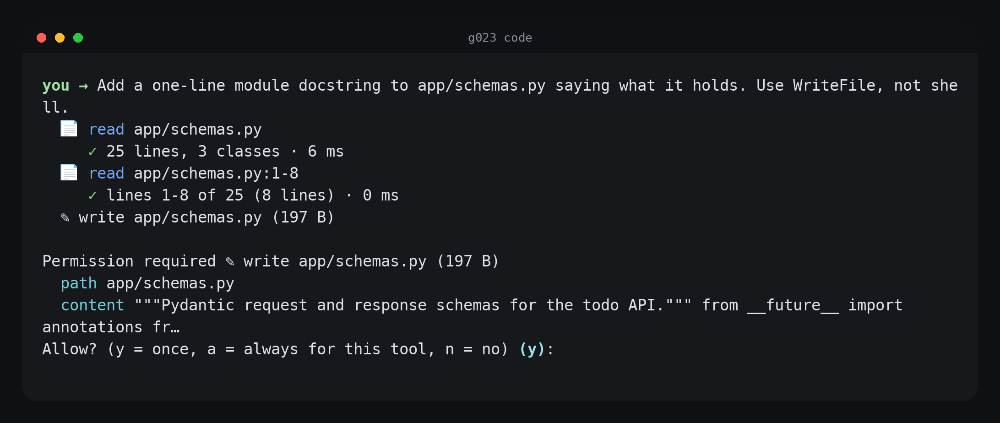](permission.png) | **`permission.png`** — `WriteFile` stops for permission. The prompt shows the path and an excerpt of the exact content, and offers `y` (once), `a` (always for this tool this session) or `n`. The trace above it also catches the summary→range escalation: `read app/schemas.py` (25 lines, 3 classes) followed by `read app/schemas.py:1-8` to get the head verbatim. |
| [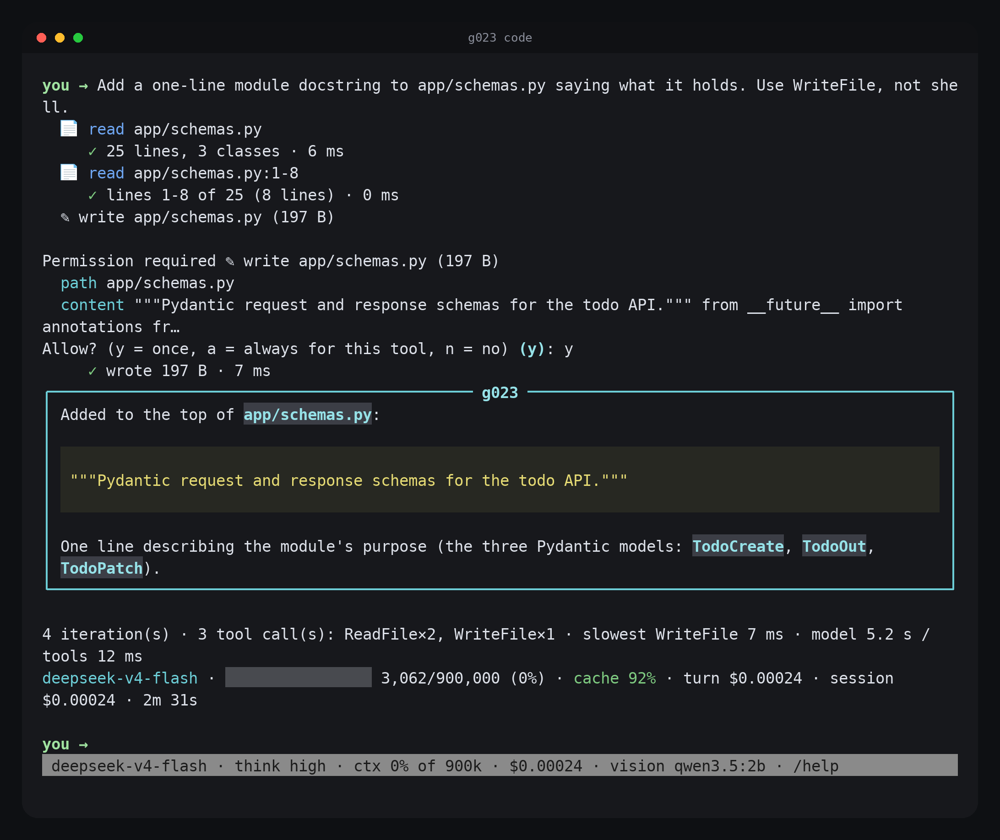](write.png) | **`write.png`** — the same turn after `y`: `wrote 197 B · 7 ms`, then the answer. |

## Compaction, step by step

These four are one continuous run: three read-heavy turns, then `/context`,
`/compact micro`, `/compact`, `/context`. See
[How compaction works](../README.md#how-compaction-works) for the mechanics.

| | |
|---|---|
| [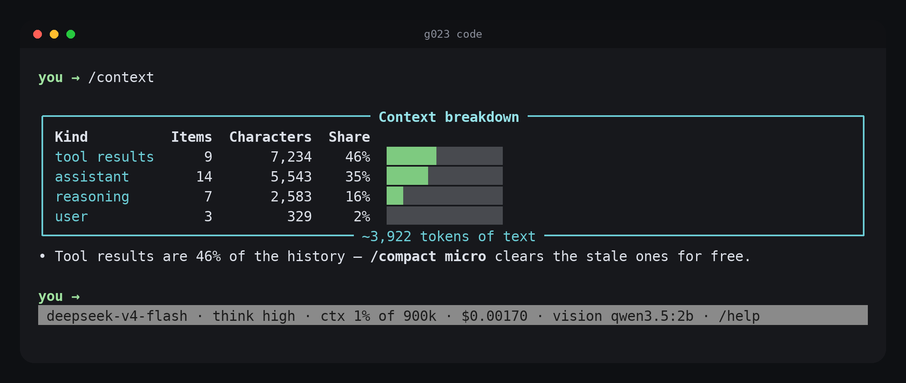](compact-before.png) | **`compact-before.png`** — before compacting: 33 items, ~3,922 tokens, tool results 46% of it. |
| [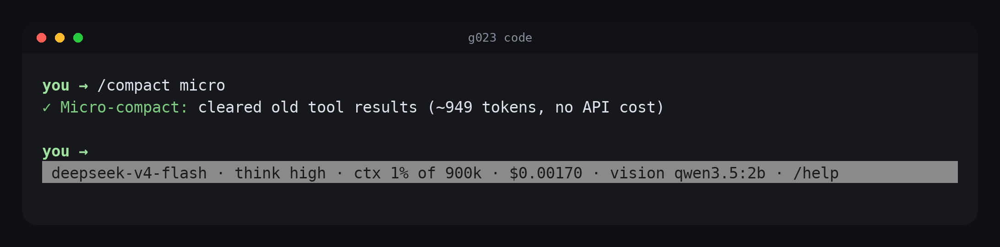](compact-micro.png) | **`compact-micro.png`** — `/compact micro`: `cleared old tool results (~949 tokens, no API cost)`. Layer 1 is local string surgery; the session cost on the status bar does not move. |
| [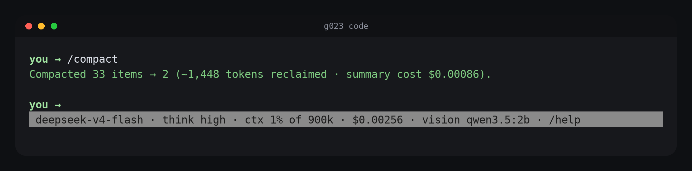](compact-summary.png) | **`compact-summary.png`** — `/compact`: `Compacted 33 items → 2 (~1,448 tokens reclaimed · summary cost $0.00086)`. Layer 3 pays the cheap model to write the summary and reports both sides of the trade. |
| [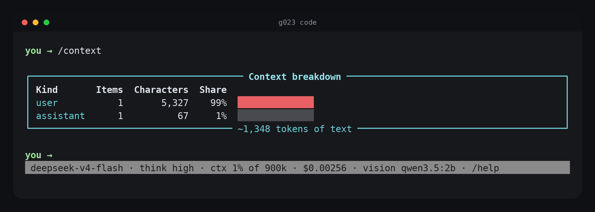](compact-after.png) | **`compact-after.png`** — `/context` afterwards: two items, ~1,348 tokens. The history is now one user item holding the summary plus one assistant acknowledgement. |

## Panels

| | |
|---|---|
| [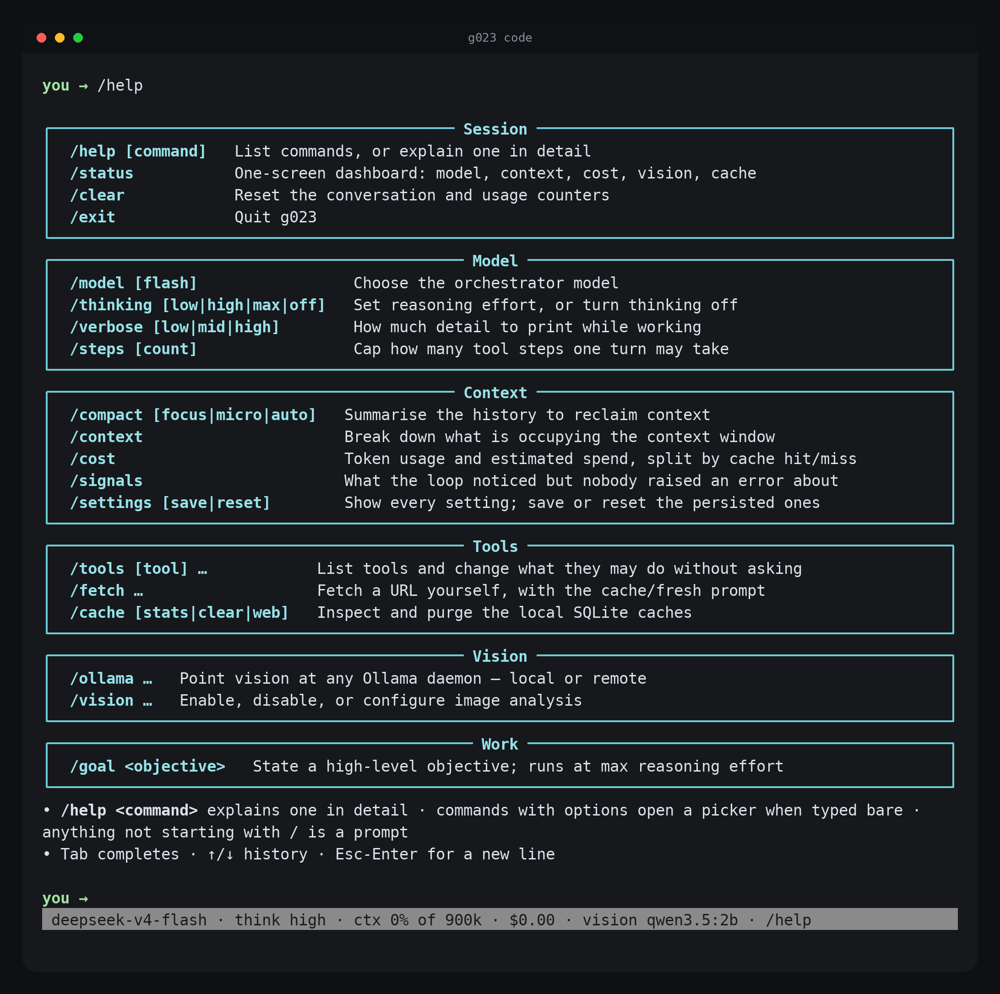](help.png) | **`help.png`** — `/help`. The whole command surface on one screen, grouped by what it touches. |
| [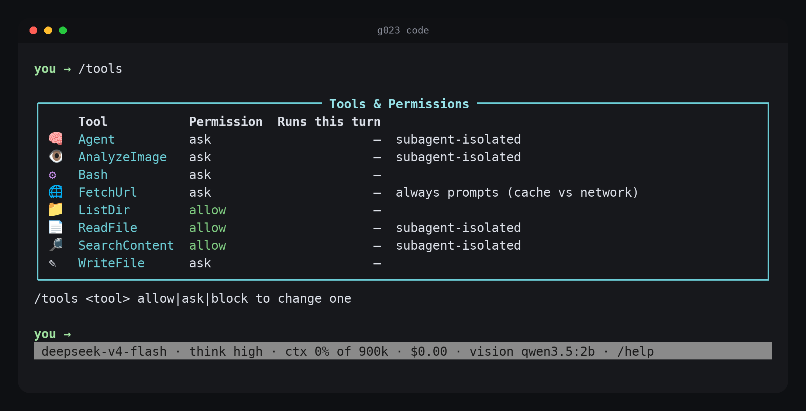](tools.png) | **`tools.png`** — `/tools`. All eight tools, their current permission, and which ones run in an isolated subagent context rather than in the orchestrator's. |
| [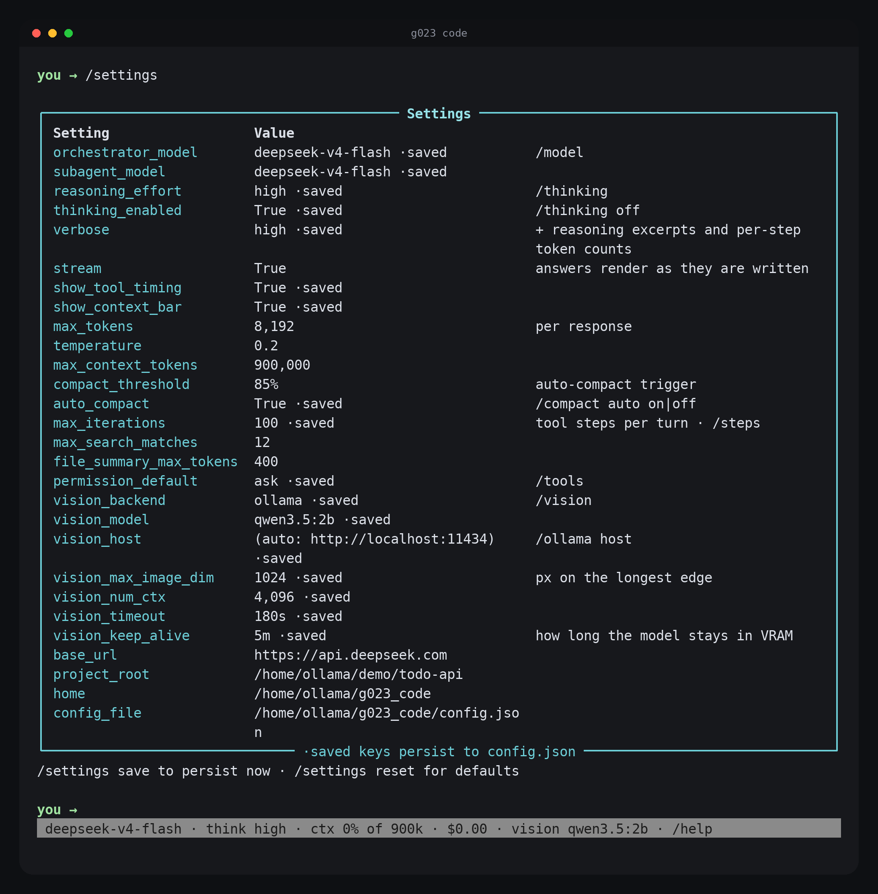](settings.png) | **`settings.png`** — `/settings`. Every setting with its live value; `·saved` marks the ones that persist to `config.json`. |
| [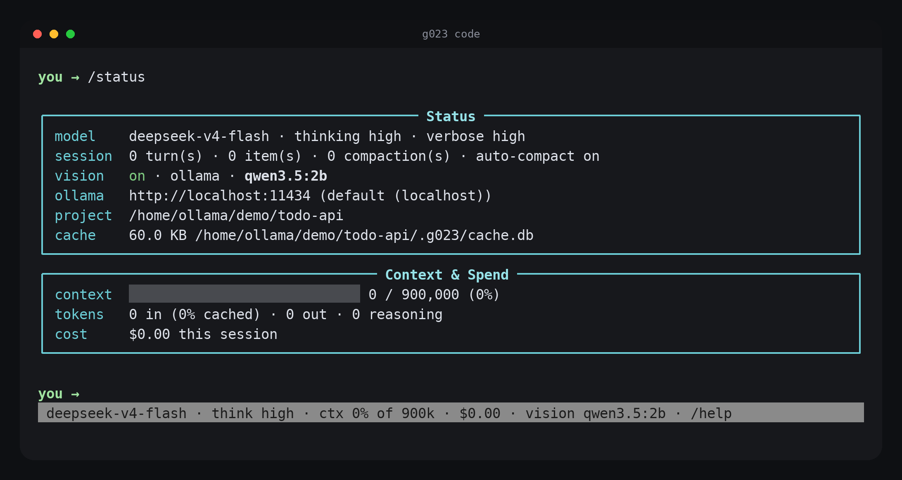](status.png) | **`status.png`** — `/status`. Model, session counters, vision, project, cache size, context and spend on one screen. |
| [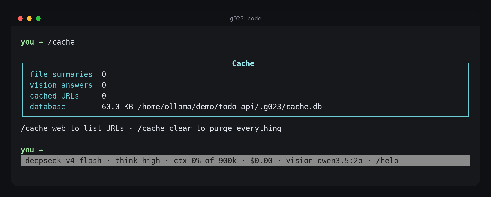](cache.png) | **`cache.png`** — `/cache`. Counts for the local SQLite caches and the database's size and path. |
| [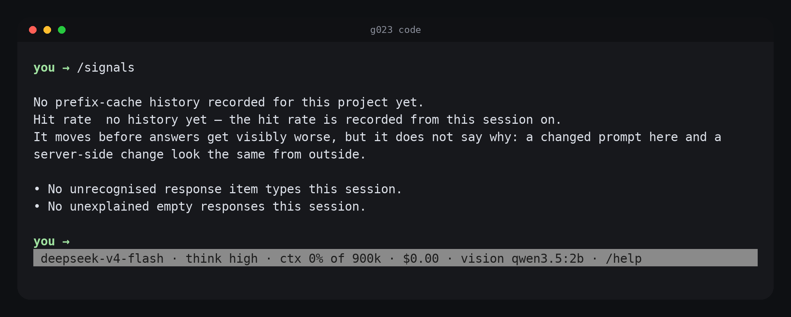](signals.png) | **`signals.png`** — `/signals`. What the loop noticed but nobody raised an error about: prefix-cache hit-rate drift, unrecognised response item types, unexplained empty responses. |
| [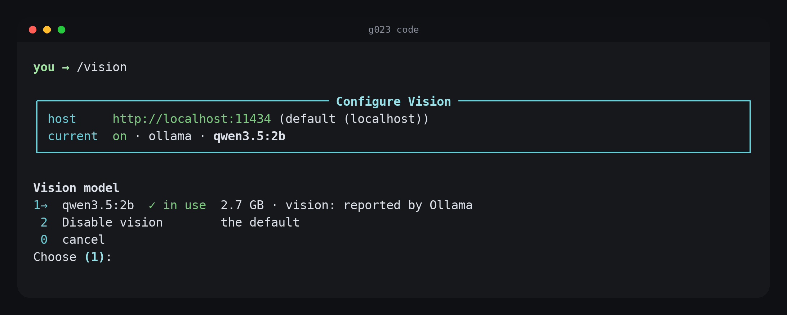](vision.png) | **`vision.png`** — `/vision` with no argument opens a picker listing the models the daemon actually reports. |
| [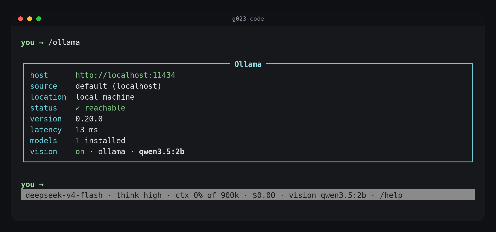](ollama.png) | **`ollama.png`** — `/ollama`. Which daemon vision is pointed at, whether it answers, its version and latency. |

---

## How these were captured

* **Version** — g023 Code 1.3.2, run from its own installation, against a small
  FastAPI todo service used as the demo project.
* **Terminal** — 100 columns × 46 rows, driven through a PTY, then re-rendered
  offline from the recorded byte stream with `pyte` + Pillow. The window chrome
  is drawn by the renderer; everything inside it is the captured screen.
* **Model** — `deepseek-v4-flash`, thinking `high`. Vision was configured to a
  local Ollama daemon running `qwen3.5:2b`.
* **Verbosity** — the panel shots were taken at `verbose high` (this machine's
  saved config). The session, write and compaction scenes set `/verbose mid`
  first, so the frames show tool traces and the per-turn accounting line without
  the model's reasoning excerpts.
* **Costs** — the session, write and compaction scenes are live API turns. Their
  dollar figures are the client's own estimates from the reported token usage,
  at the prices printed in `cost.png`; actual billing is DeepSeek's.
